# ManuOS — Software Architecture Design

| | |
|---|---|
| **Product** | ManuOS — Manufacturing Orchestration System |
| **Document** | Software Architecture Design (SAD) |
| **Version** | 1.0 |
| **Related documents** | `PRD_MANUOS_PROTOTYPE.md` · `BRD_MANUOS.md` · `PROPOSAL_DECK_MANUOS.md` · `DYNAMIC_WORKFLOW_BLUEPRINT.md` |
| **Deployment target** | Google Cloud Run (AI Builder Cup 2026 requirement) |
| **AI requirement** | Google Gemini via the Google Gen AI SDK (`@google/genai`) |

> All diagrams in this document are [Mermaid](https://mermaid.js.org) and render on GitHub, GitLab, VS Code (Markdown preview extensions), and most md viewers.

---

## Table of Contents

1. [Introduction](#1-introduction)
2. [Architecture Goals & Principles](#2-architecture-goals--principles)
3. [Architecture Decision Records (ADR)](#3-architecture-decision-records-adr)
4. [System Context — C4 Level 1](#4-system-context--c4-level-1)
5. [Container View — C4 Level 2](#5-container-view--c4-level-2)
6. [Component View — C4 Level 3](#6-component-view--c4-level-3)
7. [Domain Model — The Manufacturing Graph](#7-domain-model--the-manufacturing-graph)
8. [Deterministic Engines](#8-deterministic-engines)
9. [AI Service Layer (Gemini Integration)](#9-ai-service-layer-gemini-integration)
10. [Key Runtime Sequences](#10-key-runtime-sequences)
11. [State Machines](#11-state-machines)
12. [Deployment Architecture](#12-deployment-architecture)
13. [Security Architecture](#13-security-architecture)
14. [Performance, Scalability & Cost](#14-performance-scalability--cost)
15. [Reliability & Degradation Matrix](#15-reliability--degradation-matrix)
16. [Evolution Path to Production](#16-evolution-path-to-production)
17. [Technology Stack Summary](#17-technology-stack-summary)
18. [Appendix](#18-appendix)

---

## 1. Introduction

### 1.1 Purpose

Define the software architecture of the **ManuOS prototype** for AI Builder Cup 2026, and the evolution path from this prototype to a production platform. It translates the PRD's functional requirements into structure: components, responsibilities, interfaces, data, AI integration, and deployment.

### 1.2 Scope

- Architecture for the prototype as specified in `PRD_MANUOS_PROTOTYPE.md` (5 main features, 5 supporting features)
- Built with Google AI Studio and/or Antigravity; deployable to Cloud Run
- Production evolution described at the level of direction, not implementation detail

### 1.3 Audience

Engineers building the prototype in AI Studio / Antigravity; technical judges; future maintainers.

---

## 2. Architecture Goals & Principles

| # | Principle | Consequence in the design |
|---|---|---|
| P1 | **Graph-first** | The Manufacturing Graph (typed client state) is the single source of truth; Kanban/Gantt/tables are projections (views) of the graph, never the storage |
| P2 | **Hybrid intelligence** | Deterministic engines own every number; Gemini owns language, explanation, ideation; humans own decisions |
| P3 | **Human-in-the-loop** | AI proposals never mutate state directly; all mutations pass approval gates |
| P4 | **Transparent AI** | Every AI-generated text carries an "AI" badge; every engine number is auditable ("computed" tooltip) |
| P5 | **Graceful degradation** | If Gemini is unavailable, all deterministic panels still render; the app never breaks without the LLM |
| P6 | **Server-only secrets** | `GEMINI_API_KEY` lives only in server env (Cloud Run secret); the browser never sees it |
| P7 | **Reuse the existing codebase** | CPM engine, schema patterns, and design assets port from the ManuOS repository where possible |
| P8 | **Demo-deterministic** | Authored seed dataset + injectable disruptions make the hero scenario repeatable on any cold start |

---

## 3. Architecture Decision Records (ADR)

| ADR | Decision | Rationale | Alternatives rejected |
|---|---|---|---|
| ADR-01 | Next.js App Router (React 19, TypeScript) single app | What Google AI Studio scaffolds natively; SSR + API routes in one deployable; matches existing ManuOS codebase skills | Separate FE/BE services (overkill for prototype) |
| ADR-02 | Client-side state in Zustand, seeded on load | Instant, deterministic demos; engines run in-browser with zero latency | Server DB round-trips per interaction (slower demo, more infra) |
| ADR-03 | Deterministic engines as pure TypeScript modules | Unit-testable, auditable, cheap; port of proven ManuOS CPM code | LLM-computed numbers (hallucination risk, cost) |
| ADR-04 | Gemini calls only via Next.js API routes | Keeps the API key server-side (P6); central place for grounding contract, schemas, retries, caching | Client-direct Gemini calls (key exposure) |
| ADR-05 | Schema-constrained JSON outputs (`responseMimeType: application/json` + response schemas) | Machine-consumable, validatable; guards against free-text drift | Free-form text parsing |
| ADR-06 | Deploy as standalone Next.js container on Cloud Run | Competition requirement; existing ManuOS Dockerfile already produces standalone builds; min-instances for demo windows | Firebase Hosting (awkkward for API routes + server secrets) |
| ADR-07 | Simulated multi-tenancy for Factory Network (seeded factories, consent flags) | Demonstrates consent-first network logic without real auth/tenancy infra | Real multi-tenant auth (out of prototype scope) |
| ADR-08 | Optional in-memory server store for approved changes | Judge's approvals survive navigation within a session; honest prototype limitation documented | Full database persistence (deferred to production evolution) |
| ADR-09 | AI-generated workflows are **config artifacts** (validated DAG JSON), never executed AI free-text | Universality for any manufacturer without custom code; mirrors the production blueprint; AI proposes → engines verify → humans approve | Free-form AI process execution (unverifiable, unsafe) |

---

## 4. System Context — C4 Level 1

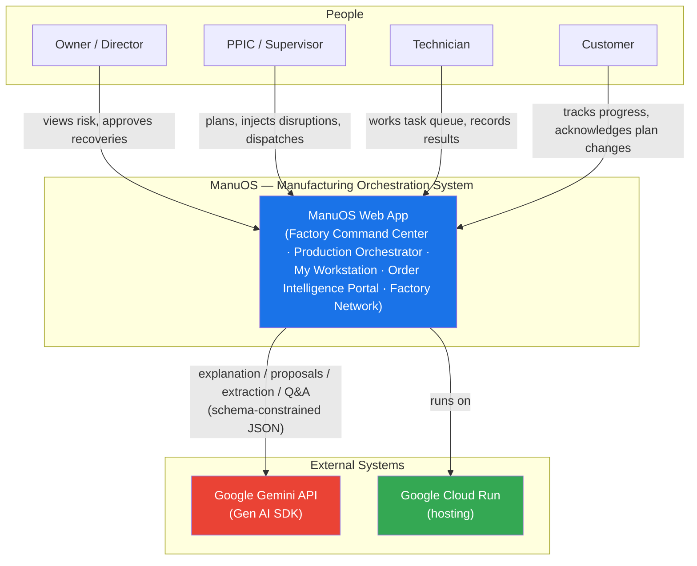

**Context notes**
- All personas use the same deployed app; persona switcher swaps the view layer (prototype). In production, personas map to authenticated roles.
- Gemini is the *only* external runtime dependency; the app is fully functional without it (P5).

---

## 5. Container View — C4 Level 2

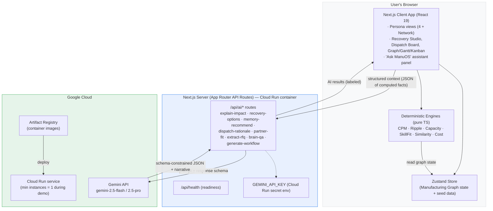

**Container responsibilities**

| Container | Responsibility |
|---|---|
| Client app | All persona UIs; renders deterministic results immediately; displays AI narrative when it arrives; approval dialogs |
| Zustand store | Single source of truth for graph state; seed loader; action log (approvals) |
| Deterministic engines | Pure functions over the store — every number on screen originates here |
| API routes | Sole Gemini access point; enforce grounding contract; validate schemas; short-TTL cache for repeat prompts |
| Cloud Run | Hosting, secrets, health checks, autoscaling |

---

## 6. Component View — C4 Level 3

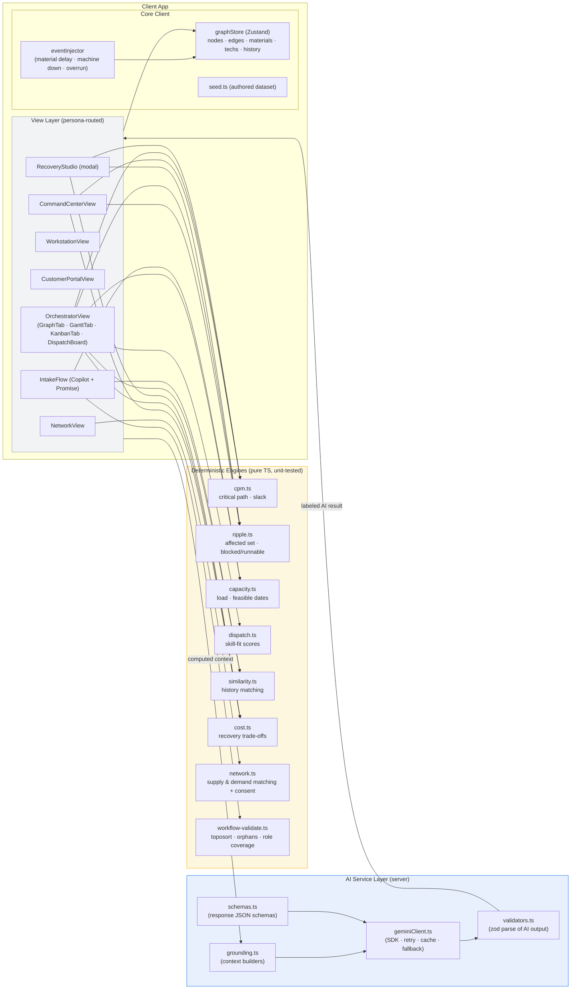

**Component contracts (summary)**

| Component | Input | Output |
|---|---|---|
| `cpm.ts` | tasks (duration, dependsOn) + start date | ES/EF/LS/LF, total/free slack, critical path, project duration |
| `ripple.ts` | disruption event + graph | affected nodes w/ paths, blocked vs runnable tasks, order-level ETA deltas |
| `capacity.ts` | machine-class load + material ETAs | earliest feasible date per request, confidence, overload warnings |
| `dispatch.ts` | task requirements + technicians | ranked candidates w/ fit score, rationale chips, gap flags |
| `similarity.ts` | planned task + HistoryEntry[] | matches + stats (mean overrun, best routing version) |
| `cost.ts` | recovery option params | timeRecovered, costImpactPct, capacityImpact, feasibility |
| `network.ts` | jobsheet/sourcing needs + factory profiles (capacity, supply offers) | ranked consenting partners (capacity subcontract or supply) + proposal draft |
| AI layer | structured context (JSON) from engines | schema-validated Gemini JSON + narrative; `null` on failure → UI shows "AI unavailable" |

---

## 7. Domain Model — The Manufacturing Graph

### 7.1 Entity-relationship diagram

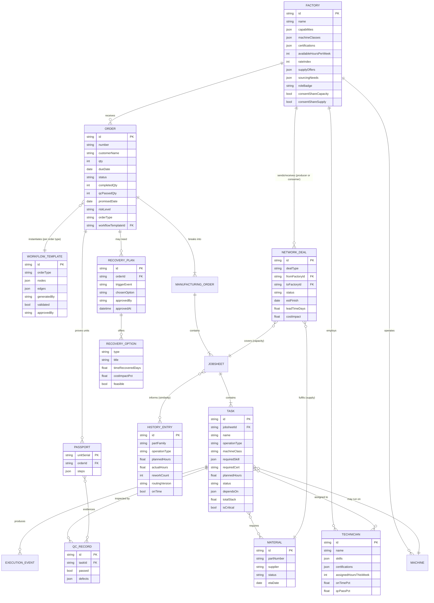

### 7.2 Graph semantics (from the workflow blueprint)

The production structure is a **DAG with loop-backs**, not a linear pipeline. The prototype models the core of the 10-department value stream:

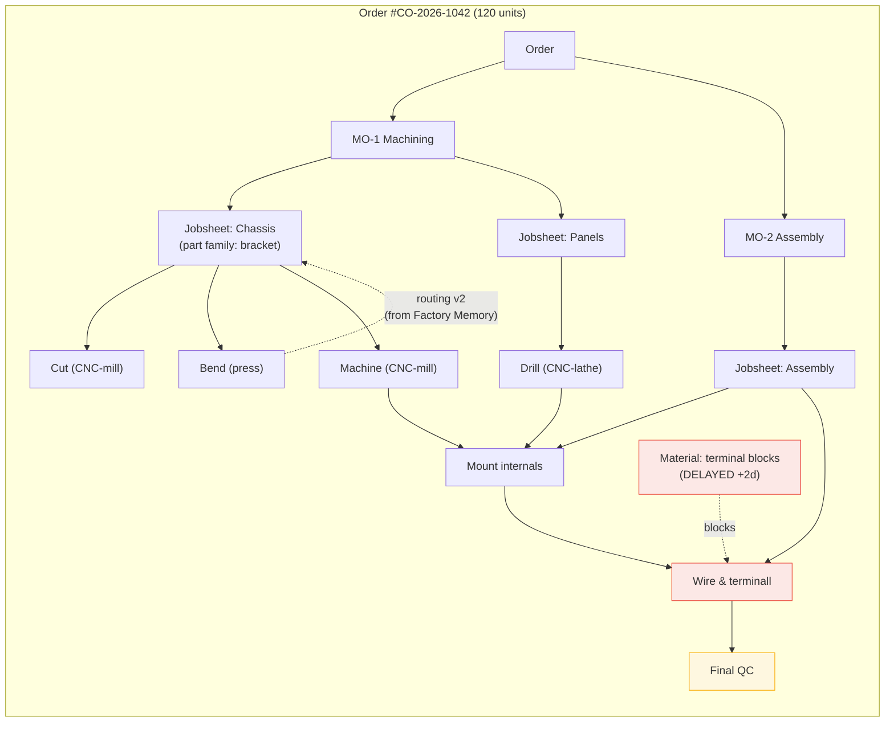

Key semantics:
- **Dependencies** (`dependsOn`) drive CPM and ripple analysis; material requirements are edges too (a delayed material blocks consuming tasks)
- **Quantities** flow node-to-node (`plannedQty → completedQty → qcPassedQty`) — "real progress" is QC-passed units
- **Cross-factory edges** (capacity subcontracts **and supply deals**) connect graphs across tenants in the Factory Network view — members act as producers and consumers in one ecosystem; a supply deal updates the buyer's material ETA and unblocks its graph
- **History edges** (similarity) link planned tasks to Factory Memory — the learning loop

---

## 8. Deterministic Engines

All engines are **pure TypeScript functions** (no I/O), unit-testable, and portable from the existing ManuOS codebase.

| Engine | Ported/derived from | Algorithm |
|---|---|---|
| `cpm.ts` | ManuOS `src/lib/critical-path/index.ts` (as-is) | Forward pass (ES/EF), backward pass (LS/LF), total slack = LS−ES, free slack = min(ES of successors)−EF, critical = slack ≈ 0 |
| `ripple.ts` | New | Reverse BFS from disruption source along `dependsOn` + material edges → upstream affected set; forward pass for downstream blocked set; classify runnable (no blocked ancestor); re-run CPM for ETA deltas |
| `capacity.ts` | New (informed by machine-lifecycle lib) | Per machine-class load histogram (assigned hours vs capacity/day); earliest-feasible-date = CPM chain on earliest free slots; confidence from slack margin |
| `dispatch.ts` | New | Fit score `0.35·skill + 0.25·cert + 0.20·workload + 0.20·trackRecord`; hard-exclude on missing required certification; rationale chips from score components |
| `similarity.ts` | New | Tag-overlap score (partFamily, operationType, material, machineClass) vs `HistoryEntry[]`; aggregate mean overrun, best routing by on-time |
| `cost.ts` | New | Parametric: option type × rates (overtime multiplier, subcontract rateIndex, split-batch logistics) → `timeRecoveredDays`, `costImpactPct`; feasibility cross-check against capacity engine |
| `network.ts` | New | Two matchers: **capacity** (consent filter → capability/cert match → availability window → rank by rateIndex & fit) and **supply** (consent filter → part/capability needed vs supply offers → lead time → rank by rate & fit) | **workflow-aware**: both matchers consider workflow step requirements from F13 templates |
| `workflow-validate.ts` | New | Topological sort, orphan-node detection, required-role coverage; rejects invalid AI-drafted DAGs (max 2 redrafts) before human approval |

**Testing strategy:** each engine gets a vitest suite with golden cases from the authored seed dataset (e.g., "terminal block delay → exactly tasks {T6, T7} blocked, order ETA +3d").

---

## 9. AI Service Layer (Gemini Integration)

### 9.1 Function catalog

| Route | Gemini model | Input context (grounded) | Output schema (constrained) |
|---|---|---|---|
| `/api/ai/explain-impact` | flash | ripple set, ETA deltas, blocked/runnable lists | `{summary, cause, blastRadius[], watchItems[]}` |
| `/api/ai/recovery-options` | flash | disruption facts + capacity data + partner matches | `{options[{type,title,description,timeRecoveredDays,costImpactPct,risks[]}]}` (validated by `cost.ts` before display) |
| `/api/ai/memory-recommend` | flash | similarity matches + aggregate stats | `{recommendation, rationale, suggestedPaddingPct}` |
| `/api/ai/dispatch-rationale` | flash | ranked candidates + score components | `{rationale, gapFlag?}` |
| `/api/ai/partner-fit` | flash | partner profiles + jobsheet/sourcing needs | `{narrative, riskNotes[]}` |
| `/api/ai/extract-rfq` | pro (quality) | pasted RFQ text | `{customer, partName, qty, material, tolerances[], ambiguities[], draftBOM[], draftRouting[], qcChecklist[]}` |
| `/api/ai/brain-qa` | flash | serialized app snapshot + question | `{answer, evidenceRefs[], linkToScreen?}` |
| `/api/ai/generate-workflow` | flash | order-type description + company profile + proven templates | `{nodes[], edges[], transitionRules[], warnings[]}` (must pass `workflow-validate.ts` before approval) |

### 9.2 Grounding contract (every prompt)

```
SYSTEM: You are ManuOS's manufacturing analyst.
RULES:
1. Use ONLY the structured context provided. Never invent numbers, IDs, dates, or entities.
2. If required information is missing, say "data not available" for that item.
3. Reference only the facts in the context when explaining.
4. Output strictly follows the provided JSON schema.
CONTEXT: {computed facts from deterministic engines}
```

### 9.3 Call flow with validation and fallback

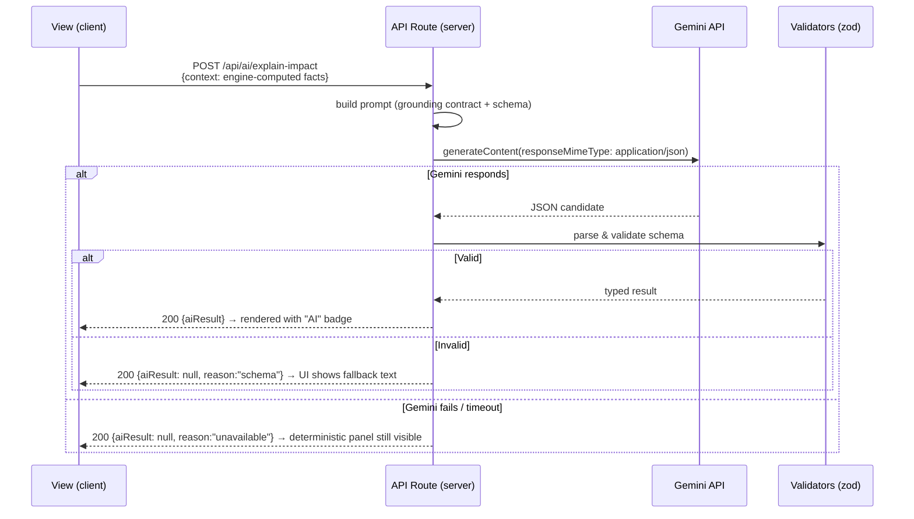

**Caching:** identical context hash → 5-minute in-memory cache (demo repeat questions are free). **Retry:** one backoff retry on transient 5xx.

---

## 10. Key Runtime Sequences

### 10.1 S1 — Disruption detection & impact analysis (F3)

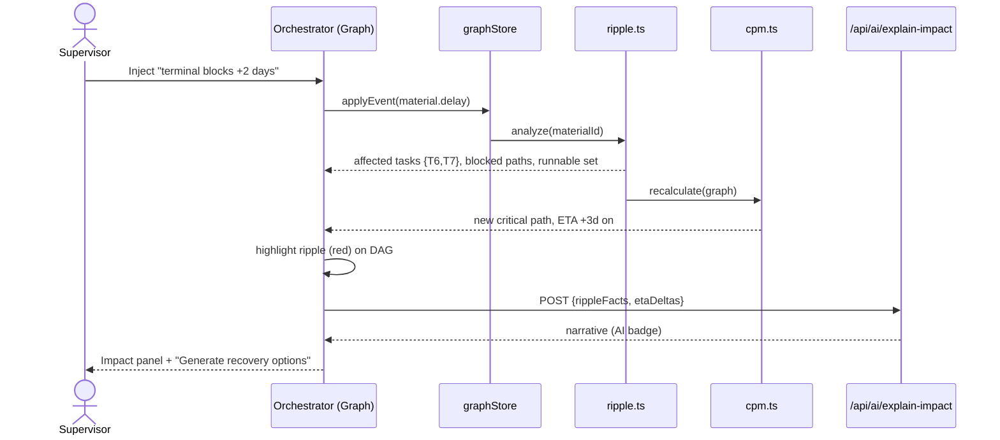

### 10.2 S2 — Recovery generation, validation & approval (F4)

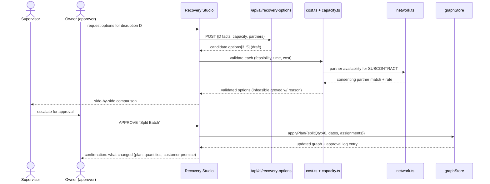

### 10.3 S3 — Skill-aware dispatch (F10)

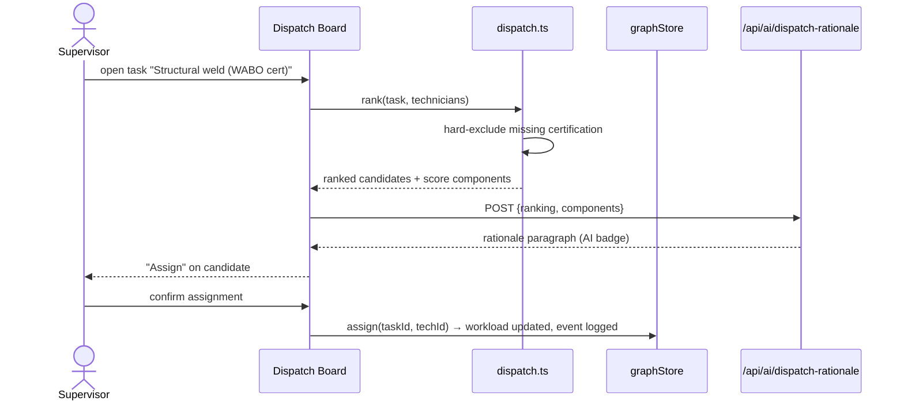

### 10.4 S4 — Promise Engine feasible date (F2)

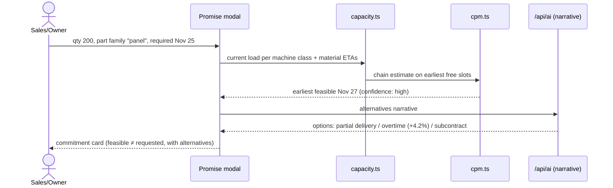

### 10.5 S5 — Engineering copilot intake (F5)

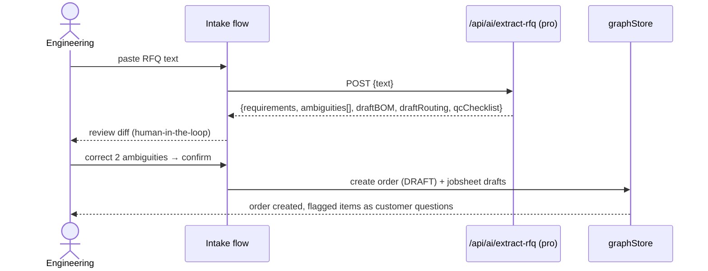

### 10.6 S6 — Factory Network: capacity subcontract & supply sourcing (F12)

```mermaid
sequenceDiagram
    actor Own as Owner (factory A)
    actor Par as Partner (factory B)
    participant NV as Network view
    participant Net as network.ts
    participant Store as graphStore

    Note over NV,Store: Direction 1 — capacity subcontract (A overloaded)
    Own->>NV: overload detected / recovery needs offload
    NV->>Net: capacityMatch(jobsheet needs, factory profiles)
    Net->>Net: filter consentShareCapacity=true
    Net-->>NV: ranked partners (B: capability 92%, 210h free, rate 1.1)
    Own->>NV: propose SUBCONTRACT to B
    NV-->>Par: inbound proposal (RFQ-style)
    Par->>NV: ACCEPT
    NV->>Store: NetworkDeal(SUBCONTRACT, ACCEPTED) + cross-factory edge
    Store-->>Own: plan updated; F4 option marked sourced

    Note over NV,Store: Direction 2 — supply sourcing (A needs materials; B/N supply them)
    Own->>NV: terminal blocks delayed / shortage
    NV->>Net: supplyMatch(material need, supply offers)
    Net->>Net: filter consentShareSupply=true → part match → lead time
    Net-->>NV: member suppliers (N: produces terminal blocks, 3-day lead)
    Own->>NV: propose SUPPLY deal to N
    NV->>Store: NetworkDeal(SUPPLY, ACCEPTED)
    Store->>Store: material ETA updated → ripple/CPM re-run → blocked task unblocked
    Store-->>Own: ecosystem loop shown: N is supplier here, capacity consumer elsewhere
```

### 10.7 S7 — AI Dynamic Workflow Generation (F13)

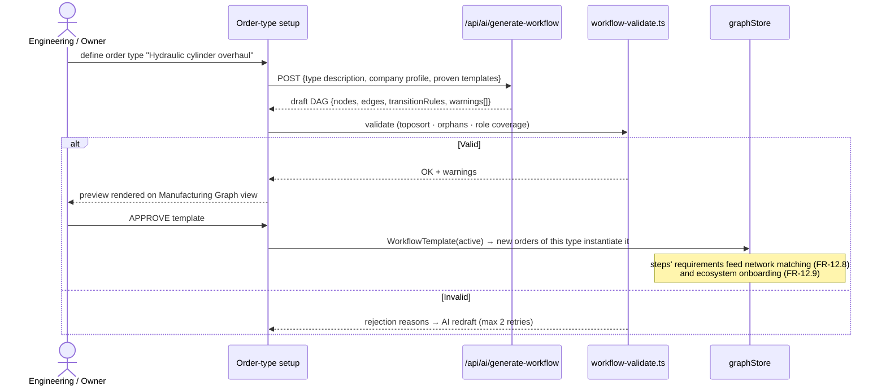

---

## 11. State Machines

### 11.1 Task status (simplified from production ManuOS)

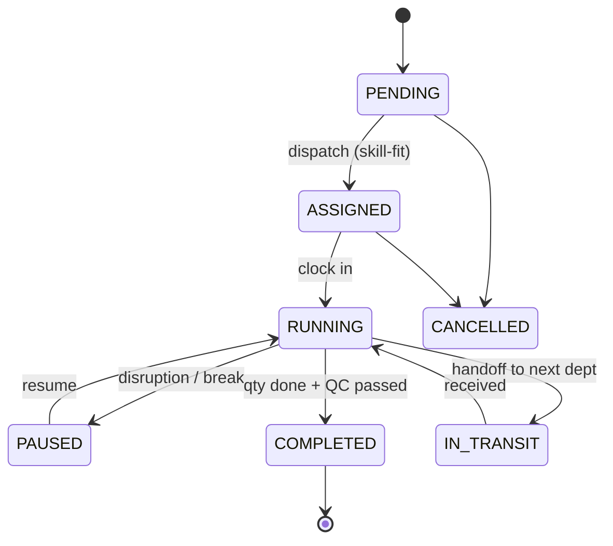

### 11.2 Recovery plan status

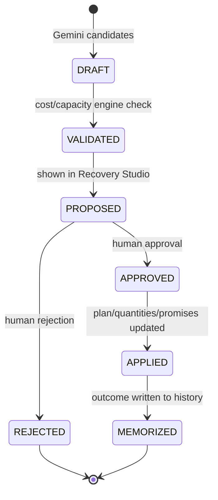

### 11.3 Network deal status (SUBCONTRACT | SUPPLY)

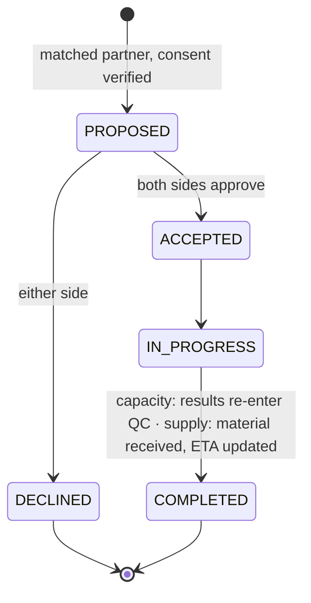

---

## 12. Deployment Architecture

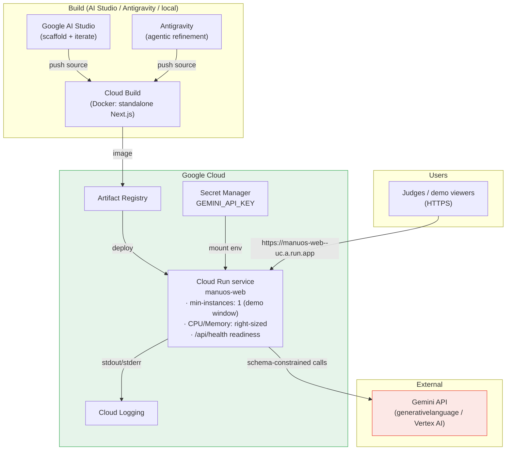

**Deployment notes**
- Build pattern already proven in the ManuOS repo: `next build` standalone output → container (see `Dockerfile`) → Cloud Run
- `GEMINI_API_KEY` **only** via Secret Manager → env; never in client bundle or repo
- Health: `/api/health` returns 200 with `{status:"ok"}` for Cloud Run readiness
- AI Studio's native deploy path to Cloud Run is the fast lane; Antigravity/Cloud Build is the reproducible lane — both end at the same service

---

## 13. Security Architecture

```mermaid
flowchart LR
    subgraph Client["Browser"]
        C1["No secrets in bundle<br/>(no Gemini key client-side)"]
        C2["AI results labeled; UI-level guardrails"]
    end
    subgraph Server["Cloud Run"]
        S1["API routes: input validation (zod)<br/>prompt-size limits"]
        S2["Grounding contract enforces<br/>'no fabrication'"]
        S3["Rate limiting per IP/session<br/>(port of ManuOS middleware pattern)"]
        S4["Security headers: CSP, X-Frame-Options,<br/>nosniff, HSTS (prod)"]
    end
    subgraph Data["Data protection"]
        D1["Demo data only — no real PII in prompts"]
        D2["Consent-first network:<br/>private factories never serialized into prompts"]
        D3["Audit log of approvals<br/>(who/when/what)"]
    end

    Client --> Server
    Server --> Data
```

Security decisions (prototype-appropriate, production-aware):

1. **Secret hygiene:** `GEMINI_API_KEY` server-only (ADR-04); documented risk if violated → disqualification-grade issue
2. **Prompt injection surface:** RFQ text is user-supplied → wrapped in a delimited block, treated as *data*, never as instructions; output schema-validated
3. **No PII:** seed dataset uses fictional entities; grounding contexts contain only operational facts
4. **Consent enforcement in code:** `network.ts` filters `consentShareCapacity=false` *before* any serialization — private factories cannot leak into AI contexts or UI
5. **Production evolution:** NextAuth credentials + role hierarchy + tenant scoping already designed in the ManuOS codebase (`src/lib/auth.ts`, `Tenant` model) — ported when the prototype becomes multi-user

---

## 14. Performance, Scalability & Cost

| Concern | Prototype approach | Production path |
|---|---|---|
| Engine latency | In-browser pure functions (<10ms on demo graph) | Same algorithms; move server-side with worker caching when graphs grow |
| Gemini latency | `gemini-2.5-flash` for narrative; deterministic panels render first, AI streams in after | Streaming responses (`streamGenerateContent`) for assistant UX |
| Gemini cost | 5-min cache on identical contexts; ~7 short calls per demo run — fractions of a cent | Flash-tier default + pro only for extraction; batch analytics offline |
| Cold starts | Cloud Run min-instances=1 during demo window | Always-on small instance + CDN for static |
| State size | Authored seed (~14 tasks, 10 techs, 4 factories) trivially fits memory | Postgres + Prisma (production schema already exists in ManuOS repo, 22 models) |
| Concurrency | Single-session demo (persona switcher) | Multi-user via sessions + optimistic locking on graph mutations |

---

## 15. Reliability & Degradation Matrix

| Failure | User-visible behavior | Data integrity |
|---|---|---|
| Gemini API down / timeout | "AI narrative unavailable" badge; **all deterministic panels, scores, and ETA math still render**; recovery options still generated from a **template-based fallback** option generator (rule-based drafts, clearly labeled non-AI) | No state change without approval (unaffected) |
| Gemini returns invalid schema | zod rejects; UI shows fallback text; error logged server-side | Unchanged |
| Recovery option infeasible | Greyed card with engine's reason; cannot be approved | Approval gate blocks impossible plans by construction |
| Seed/reset mid-demo | Persona switcher includes "Reset demo data" — instant reseed | Cold-start deterministic |
| Cloud Run instance restart | Session store resets to seed (documented prototype limitation) | Honest limitation; production persistence in §16 |

---

## 16. Evolution Path to Production

The prototype is intentionally lean; the production platform grows along five axes, all pre-designed in the existing ManuOS codebase:

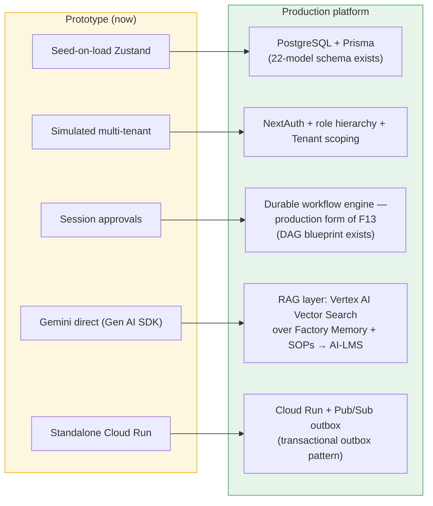

Key production assets already in the repository (reference implementation):

| Production concern | Existing asset |
|---|---|
| Data model | `prisma/schema.prisma` — Tenant, Order→MO→Jobsheet→Task, Machine lifecycle, Inventory, Handoff, AuditLog |
| Auth & RBAC | `src/lib/auth.ts` (NextAuth, 7-role hierarchy), `src/middleware.ts` (rate limit, headers, route protection) |
| Workflow semantics | `docs/DYNAMIC_WORKFLOW_BLUEPRINT.md` — config-driven DAG engine, node/action components, outbox |
| CPM | `src/lib/critical-path/index.ts` (already ported into the prototype) |
| Machine intelligence | `src/lib/machine-lifecycle/` (runtime thresholds, MTBF, availability) |

Future feature hooks (from the roadmap): `KnowledgeEntry` + vector embeddings power the **RAG + AI-Based LMS Competency Engine**; Visual QC adds an image-input Gemini flow; Profit Radar extends `HistoryEntry` with cost fields — none require architectural rewrites.

---

## 17. Technology Stack Summary

| Layer | Technology (prototype) | Notes |
|---|---|---|
| Framework | Next.js (App Router) + React 19 + TypeScript | AI Studio scaffold; matches ManuOS repo |
| UI | Tailwind CSS + shadcn-style components | Professional light theme; accessible |
| State | Zustand | Manufacturing Graph single source of truth |
| Engines | Pure TypeScript (vitest-tested) | CPM ported from ManuOS |
| AI | Google Gemini (`@google/genai`), server-side only | flash default; pro for extraction; schema-constrained JSON |
| Validation | zod (AI outputs + API inputs) | Grounding enforcement |
| Runtime | Node.js 20 (standalone build) | Existing Dockerfile pattern |
| Hosting | Google Cloud Run (+ Secret Manager, Logging) | Competition requirement |
| CI | GitHub Actions → Cloud Build → Cloud Run | Existing workflows in repo |
| Testing | vitest | Engine golden cases from seed data |

---

## 18. Appendix

### 18.1 Glossary

**ManuOS** — **Manu**facturing **O**rchestration **S**ystem (official name expansion). **Dynamic Workflow** — an order-type-specific production DAG (departments, nodes, dependencies, fan-outs, loop-backs) that is AI-drafted, deterministically validated, and human-approved; the reason any manufacturer can run on ManuOS, and the basis of workflow-aware network matching. **Manufacturing Graph** — the connected domain model (orders→tasks, dependencies, materials, machines, people, quality, history) that is the single source of truth. **CPM** — Critical Path Method. **Ripple set** — all nodes affected by a disruption. **Real progress** — QC-passed units ÷ ordered units. **Grounding contract** — prompt rule set restricting Gemini to provided facts. **Consent-first** — no factory data leaves its tenant without an explicit opt-in flag. **Recovery option types** — SPLIT_BATCH, ADD_SHIFT, REROUTE, REASSIGN, SUBCONTRACT. **Network deals** — SUBCONTRACT (capacity) and SUPPLY (materials/components) agreements between consenting factories; roles are fluid — producer today, consumer tomorrow — so every member sits inside the supply chain loop.

### 18.2 Traceability

| PRD feature | Architecture sections |
|---|---|
| F3 Dependency Intelligence | §6 (`ripple.ts`, `cpm.ts`), §10.1 |
| F4 Self-Healing | §6 (`cost.ts`), §10.2, §11.2 |
| F7 Factory Memory | §6 (`similarity.ts`), §10 via memory cards |
| F10 Skill-Aware Dispatch | §6 (`dispatch.ts`), §10.3 |
| F12 Factory Network (supply & demand ecosystem) | §6 (`network.ts`), §7 (`NETWORK_DEAL`), §10.6, §11.3 |
| F1/F2/F5/F8 supporting | §9.1, §10.4, §10.5 |
| F13 AI Dynamic Workflow Generation | §3 (ADR-09), §6 (`workflow-validate.ts`), §7 (`WORKFLOW_TEMPLATE`), §9.1, §10.7 |
| Compliance (Gemini, Cloud Run, English) | §5, §9, §12 |

### 18.3 References

- `PRD_MANUOS_PROTOTYPE.md` — functional requirements, demo scenario, build plan
- `BRD_MANUOS.md` — business problems, benefits, KPIs
- `DYNAMIC_WORKFLOW_BLUEPRINT.md` — production workflow engine design (10-department interview source)
- AI Builder Cup 2026 — Challenges & Requirements (aibuildercup.com/themes.html)
