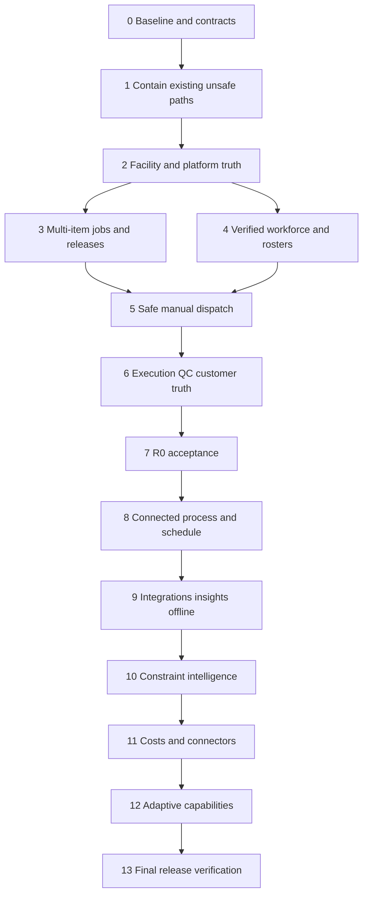

# CoreOS product revision completion plan

## Primary goal

A manufacturer can fulfill a multi-item custom order through released engineering, qualified conflict-free assignments, evidenced execution, reconciled QC and truthful customer milestones. Complete the revised R0–R3 roadmap progressively, admitting intelligence and external collaboration only when their operational data and approval gates are proven.

Date: 2026-10-16. Baseline: `feat/product_rev` at `cf282ba`. Status: implementation in progress in `/Users/ardian/.codex/worktrees/2789/manuos-sg`; all phases and release gates remain open until their plan evidence is attached. Latest local verification on 2026-10-16 after the current Shop Floor queue/profile slice: `npm run typecheck` passed; serial full Vitest passed (72 files / 386 tests); `npm run build` passed (129 static pages). `git diff --check` passed. Browser, operational-database, backup/restore and pilot gates remain open. Companion: [gap audit and all 79 capability assessments](../../product-rev-gap-audit.md) and [implementation status/evidence](../../product-rev-implementation-status.md).

Re-audit count on 2026-10-16: 66/93 checklist items marked implemented/evidenced, 27 still open (~29%). This is a plan-checkbox ratio, not product/release completion. Shop Floor queue/profile copy and offline-scan corrections passed local typecheck, full Vitest and production build; the user should still review the rendered UI. External browser, pilot, operational DB, restore and measured-performance gates remain open.

## Product authority and execution rules

- Read `docs/product_rev/CoreOS_BRD_v1.docx`, `CoreOS_PRD_v1.docx`, `CoreOS_Database_Architecture_Schema_v1.docx`, `CoreOS_Feature_Breakdown_v1.xlsx` and `CoreOS_SQLite_Schema_v1.sql`. Feature IDs/releases/dependencies come from workbook **Feature Backlog rows 7–85**. All nine sheets were reviewed. Totals: R0 36, R1 24, R2 12, R3 7. No dates or effort commitments are inferred from workbook size labels.
- Apply mandatory `AGENTS.md`, `docs/DESIGN.md` and UI restoration visual contract. Keep Next/React/Prisma, workspace tenancy, principal authorization, command/audit contracts, bigint atoms, double-entry stock and exact finalized QC conservation. Do not execute the reference SQL as an application migration or switch to Drizzle.
- Preserve current operational IDs/history, Better Auth accounts and existing unrelated changes. No commit/push/deployment is part of executing this plan unless separately requested. Audit code references are for `cf282ba`; re-read current files before each phase.
- Checkboxes below describe implementation progress, not source existence. Mark a task complete only with attached evidence. Record current commands, environment, request IDs, DB readback and limitations in a phase evidence file; never infer fresh success from historical status reports.
- Extend existing services and shared UI primitives. Use centered CRUD modals and contextual read-only drawers. Keep icons/tooltips/overflow actions, typography, pagination/search and shell ownership consistent with the current visual contract. English prototype copy does not satisfy the revised Bahasa Indonesia default requirement.
- Read and amend `contracts/openapi.yaml` alongside DTOs and routes before changing API semantics. Use Postman's API engineering/documentation/testing workflow for implementation; external-provider discovery applies when choosing actual connectors. No remote workspace creation or publication is needed for this local audit.
- At each phase, distinguish source review, isolated DB tests, HTTP behavior, browser evidence and pilot evidence. `tests/e2e` currently contains Vitest route/service tests; add actual browser evidence for user journeys. Run typecheck for every completed phase, targeted tests for touched invariants, and full regression at the release gates.

## Allowed existing APIs and patterns

These are observed APIs, not proposed additions. Check their current implementation before reuse; known unsafe preflight behavior must be corrected rather than copied.

| Concern | Existing contract and copy location |
| --- | --- |
| Authentication | `requirePrincipal(req: Request | Headers, workspaceCodeOrId?, prismaClient?)`, `src/server/auth/auth.ts:187`; pass actual Request/Headers |
| Authorization | `requirePermission(principal, code)` / `requireAnyPermission(principal, codes)`, `src/server/auth/permissions.ts`; customer ownership in `auth/policy.ts` |
| Atomic command | `executeCommand<TInput,TOutput>(options)`, `src/server/db/transaction.ts:62`; handler receives `(tx, {requestId, principal})`, returns data/aggregate/resourceVersion and optional previousVersion/auditDetails |
| HTTP mutation | `handleMutationRoute(req, schema, handler)`, `src/server/http/route-handler.ts:63`; handler context carries principal/requestId/idempotencyKey/expectedVersion. Authorization still belongs in the service |
| Quantity | `parseQuantity(value: string, allowedPrecision = 6): bigint`, `src/domain/quantity.ts:11`; `formatQuantity(atoms: bigint): string` at `:56`; actual signatures are narrower than AGENTS examples |
| Stock | `postMovement(tx, principal, input, commandId?)`, `src/server/modules/inventory/ledger.ts:10`; `reconcileStock(db, workspaceId)` at `:231`; positive atom input, existing supported movement types only |
| Release/instantiation | `releaseOrder(principal, orderId, idempotencyKey, prisma?)`, `orders/release.ts:10`; `instantiateWorkflow(input)`, `workflow/instantiate.ts:22`; extend their transaction rather than creating a second release authority |
| Planning | `PlanningService.evaluateAssignment(principal, rawInput)`, `planning/service.ts:40`; `assignTask(principal, rawInput, idempotencyKey?)` at `:226`; `scheduleTasks(principal, rawInput)` at `:376` |
| Forms | `FormService.bindFormVersion`, `createFormInstance`, `forms/service.ts:385`/`:419`; `FormSubmissionService.finalizeSubmission` and `createCorrection`, `forms/submissions.ts:234`/`:349`; `assertRequiredFormsFinalized(tx, input)` in `forms/completion.ts` needs missing-binding handling |
| Execution/QC/delivery | `ExecutionService.startTask/pauseTask/resumeTask`; `recordOutput(db, principal, rawInput, idempotencyKey?)`; quality `createInspection/finalizeInspection/authorizeRework/recordReinspection`; `DeliveryService.allocateShipment/dispatchShipment/confirmDelivery` |
| Read-only AI | `buildAuthorizedContext`, `src/server/ai/context.ts`; `answerProductionQuestion`, `ai/brain.ts`; typed `Explanation<T>`, citation validation and scoped cache patterns, with hardening listed below |
| Test fixture | `const fixture = await createFactoryFixture()` in `tests/fixtures/factory.ts`; close via `afterAll(async () => { await fixture.close(); })`; `tests/integration/commands.test.ts`, `order-release.test.ts`, `output-quality.test.ts` and `customer-evidence.test.ts` are extension seams |

## Dependency sequence

Phases 3 and 4 may be separate implementation contexts after shared facility contracts settle. Both must finish before safe dispatch. Each later phase extends the same domain command path; none may bypass an earlier hard gate.

## Phase 0 — Documentation discovery and reconciled baseline

**How this serves the primary goal:** Establish one agreed contract so existing data and working functionality survive the product revision.

Status: **audit/planning discovery complete**; implementation baseline tasks remain open.

Documentation: all five product inputs; BRD §§5–9; PRD §§5–8, 11–14; workbook Decisions/Data Model/Acceptance Tests; database architecture §§10–13; companion audit.

- [x] Read all latest artifacts and inventory 79 requirements, 15 functional acceptance scenarios, 12 database scenarios and release dependencies.
- [x] Trace models, services, route/UI reachability and existing test seams; record actual allowed APIs and conflicts in the audit.
- [x] Run planning-time typecheck: exit 0. No application tests or runtime claims.
- [x] Create implementation evidence baseline: branch/status, resolved DB/storage locations, migration history, actual runtime PRAGMAs, stock reconciliation and consistent backup/restore into a disposable location. Operational DB was unavailable; evidence is explicitly limited to an empty disposable database.
- [x] Approve a contract reconciliation note: Workspace = tenant; facilities additive; existing states mapped to business semantics; 10^6 atoms; integer money/rates; Prisma migration owner; centered CRUD; exclusive default resources; R0 read-only portal. See [implementation status](../../product-rev-implementation-status.md#reconciled-technical-contract).
- [x] Record pilot decisions with owners: tracking grain/split semantics (PPIC+QC), safety qualifications (Supervisor+HSE), shift/HRIS source (HR+PPIC), capacity sharing (Plant Manager), partial-release/change authorities (Engineering+Warehouse), visible dates/shares (Sales), deployment/retention (IT). Defaults and unresolved decisions recorded in [implementation status](../../product-rev-implementation-status.md#pilot-decisions-and-owners).
- [x] Create a requirements evidence register with all feature IDs plus BR-01–BR-17, AC-01–AC-15, DB-01–DB-12 and KPI-01–KPI-10. See [implementation status](../../product-rev-implementation-status.md#requirements-evidence-register); keep old reports marked historical.

Verification: no missing IDs; source links resolve; restore/integrity/reconciliation baseline captured; unresolved business decisions have owner and explicit blocking phase. Discover real API signatures before creating tickets.

Guards: no standalone schema import, bulk rename/rewrite, new dependency merely to match examples, or conversion of old seed/demo results into pilot evidence.

## Phase 1 — Contain current authorization, booking and quantity defects

**How this serves the primary goal:** Stop current APIs from confirming unsafe work or exposing misleading production evidence while larger models are introduced.

Scope: immediate portions of PLT-02/03, ENG-04, SCH-02/03, SFL-02/03, QLT-05 and AII-06. References: audit G01/G06–G08/G11/G12; PRD §6.3 and AC-05/06/08/11/15; SQL overlap trigger intent at lines 1437–1469.

- [x] Protect or retire all legacy `/api/ai/{explain-impact,dispatch-rationale,partner-fit,recovery-options,promise-explain,memory-recommend}` handlers. Follow `requirePrincipal` and service permissions, scope cache/context to authorized evidence, remove invented fallback quantities/certifications/history and return explicit unavailable data when evidence is absent.
- [x] Add permission enforcement to planning evaluation and audit every reachable read/mutation relevant to this revision. Demo-only modal visibility is not endpoint authorization.
- [x] Make existing booking overlaps hard failures, validate both interval endpoints/start<end, reject omitted required resources, re-read readiness/resources/overlaps under `executeCommand`, add expected-version/CAS protection and reviewed insert/update exclusion migration for exclusive bookings. Recheck a defaulted slot inside the transaction too.
- [x] Preserve task assignment and booking agreement on partial updates: update/cancel technician and machine independently; do not keep an assigned resource while dropping its booking. Failed reassignment must preserve the prior booking and audit state.
- [x] Remove first-active-technician fallback; use principal-linked operator or explicit authorized supervisor action with reason. Add assignment ownership checks on pause/resume/output as well as start.
- [x] Move output, QC disposition and delivery stock/state/balance guards into the committing transaction. Enforce per-stage available WIP, positive atom values, accepted/shipped caps and aggregate bucket allocation. Reject any unsatisfied required consumption; do not silently post partial consumption and full output.
  - Evidence revalidated 2026-10-16: output re-reads task/order/item demand and WIP movements in the committing command; QC revalidates cumulative inspection allocation, checklist and destination; shipment allocation/dispatch/delivery re-read mutable line, QC and stock state transactionally. The latest serial full suite passed 71 files / 384 tests, including execution, QC, delivery and material custody regression coverage; see implementation status.
  - Progress 2026-10-16: final output/task targets, shipment allocation stock/QC checks, per-line caps, and cumulative QC target checks have source changes. This inline slice rechecks output destination/item/demands in the command transaction, prevents caller-controlled finality, rechecks task readiness/material coverage at execution start, and bounds initial QC allocations and rework/reinspection in their transactions. WIP consumption is attributed to order-issued lots; same-item demand attribution, complete QC rollback/concurrency evidence, and final verification remain open.
  - Progress 2026-10-16: material issue now re-reads its demand/source/destination inside the committing transaction, rejects a referenced reservation from another demand/item/task/lot, and refuses to clamp a missing/short bucket reservation. QC finalization/reinspection now revalidate current checklist readings and require active FG/SCRAP destinations in the transaction. Regression cases were added for cross-demand reservation use, wrong-kind QC destinations, and unsafe numeric atom inputs; verification is pending.
- [x] Remove fractional numeric atom flooring and floating BOM conversions. Use decimal strings/`parseQuantity`, bigint atom arithmetic, rational conversions and integer allowance basis points with a reconciled migration from Float. Preserve APIs through explicit compatibility rules where needed, never silently round operational inputs.
  - Evidence revalidated 2026-10-16: BOM requirements use integer ceiling division and `allowanceBps`; migration `20261016140000_bom_line_allowance_bps` backfills the legacy Float column before new workflow instances use basis points. `parseAtomInput` rejects fractional/unsafe numeric atoms. Latest serial full suite passed 71 files / 384 tests, including quantity and Phase 1 containment regression coverage; see implementation status. Conversion of external intelligence DTOs remains separately open where it still uses whole-unit numbers.
  - Progress 2026-10-16: engineering draft quantities use decimal strings and exact UOM precision; workflow BOM expansion now uses integer ceiling division and basis points without Float arithmetic; recovery currently fails closed for fractional and unsafe-range quantities. A repository-wide arithmetic audit, legacy Float reconciliation, and final verification remain open.
- [x] Restrict unsafe recovery approval until it resolves a persisted proposal and revalidates it; a command receipt does not make client-provided tranches authoritative.
  - Progress 2026-10-16: proposals now persist by workspace/order and approval refuses to claim APPLIED while schedule/shipment mutation is unsupported. Approval validates the persisted option and tranche payload, then fails closed because no schedule change or shipment reservation is applied. Final QC scope, multi-line support, safe quantity representation, and final verification remain open.
- [x] Immediately fix passport order/job scoping and external PII projection, or disable external exposure until that evidence is available. Do not publish a synthetic evidence digest or RELEASED fallback.
  - Progress 2026-10-16: customer reads verify order ownership and item scope, then fail closed until immutable per-unit snapshots exist; staff/customer views no longer expose legacy RELEASED digest rows, and publication refuses to create a synthetic digest. The portal omits passport rows pending verified snapshots. Canonical immutable genealogy snapshots, full customer/serial scope audit, and browser verification remain open.
- [x] Wire reliable SQLite connection initialization; `configurePrismaSqlite` at `db/client.ts:18` currently has no runtime initializer caller. Preserve runtime API compatibility and verify actual connection behavior.

Copy patterns: `transaction.ts:62`, `handleMutationRoute`, `auth/permissions.ts`, atom parsing and ledger movement paths. Correct existing service preflight holes rather than copying them.

Verification: targeted negative HTTP/service cases for unauthenticated/customer callers, conflict insert/update/touching boundaries, two concurrent planners and two concurrent outputs/QC/deliveries, stale task versions, insufficient WIP, cross-customer passport and fabricated fallbacks. Assert rollback includes stock/task/bookings/events/receipts. Typecheck, focused tests, reconcile disposable DB.

Guards: warnings cannot waive safety conflicts; no nested raw `BEGIN IMMEDIATE` inside Prisma transactions; no authorization inferred from a UI button; no bypass for AI/admin approval of mandatory qualification rules. Full new qualification/roster semantics land in phases 4–5.

## Phase 2 — Facility-scoped platform, reference data and notifications

**How this serves the primary goal:** Ensure every order, person, resource and event belongs to the correct operating site and reaches the responsible user.

Scope: complete PLT-01–PLT-05. References: PRD PLT/§11, BRD stakeholder boundaries, architecture DB-01/05/06/10, workbook Data Model rows 7/18. Extend `schema.prisma:93/160/275`, `server/modules/access/service.ts`, `masters/service.ts`, `auth/principal.ts` and shared settings UI.

- [x] Add Facility under Workspace, site timezone and policies, facility grants for membership/role access, and explicit ownership on operational/resource records. Backfill one default facility per workspace using documented mapping, preserving workspace/customer boundaries. Departments/warehouse locations do not automatically become facilities.
- [x] Expand server Principal-derived authorized scope and enforce it across lists/counts/search/detail/mutations/AI/documents/export; client selected facility is a filter, never a grant. Preserve users shared across workspaces and last-admin protection.
  - Progress 2026-10-16: Closed the execution-specific gap found during audit: Shop Floor task lists/details/start/pause/resume, output recording, issue create/list/resolve/reopen, and task/order/job QR lookup now constrain their Order facility by Principal grants. Orders outside the authenticated facility grants, including unassigned legacy rows, are inaccessible; fixtures now model migrated default-facility membership. Verification is pending with the final pass.
- [x] Add typed configurable issue/pause reasons, priority and allowed stage labels, keeping semantic states/guards fixed. Reuse master catalog edit/archive/version patterns.
- [x] Extend immutable domain event/audit fields with reason, source/schema version and durable correlation/request links. Add append-only event protection and correction/reversal links; retain mutable projections separately. Resolve idempotency key/command namespace and concurrent replay semantics without invalidating historical receipts.
- [ ] Add durable notification inbox/preferences, recipient scope, event dedupe, unread/read state, entity links and failure observability. Emit assignment/release/approval/blocker notifications transactionally; build a small in-app inbox. External channels remain phase 11.
  - Progress 2026-10-16: Preferences now have a versioned/audited/replay-safe API and centered settings dialog. Assignment/release/engineering-approval/blocker events use recipient facility grants and durable dedupe. Muted notices retain SUPPRESSED disposition/reason; actual delivery failures emit structured logs and abort the business transaction. Final verification remains in progress.
  - Progress 2026-10-16: Fresh migration deployment exposed that the Prisma model's `dedupeKey` column/index were absent from the migration chain. Added an additive migration after preserving existing history. Fresh and incremental disposable migration deployment and SQLite integrity/column/index readback pass; focused Phase 2 plus execution notification suites pass. Concurrent duplicate-delivery behavior and operational durability remain open.
  - Progress 2026-10-16: Inbox rows for orders, tasks, inspections and task issues now link to their related workspace detail route (issue notices carry the owning task ID). OpenAPI describes the returned subject metadata. Preferences and delivery/failure observability are still missing; browser navigation and accessibility review remain open.
- [x] Add locale infrastructure with Bahasa Indonesia default, English option if needed, facility-aware date/time formatting and UTC storage. Reuse the current Plus Jakarta Sans light UI, shared controls and single shell.

Verification: two workspaces, two sites each, restricted/global grants; cross-site FK/service denial; customer and technician boundaries; notification recipients/idempotency/rollback/read-state; append-only rejection/correction; default-facility migration count/ID/atoms/ledger checks; timezone/locale formatting and keyboard/accessibility on settings/inbox.

Guards: no parallel identity system, global permission bypass, free-text state transitions, unfettered platform-admin operational access, fake inbox items or new inventory source of truth.

## Phase 3 — Multi-item orders, bounded jobs and released engineering

**How this serves the primary goal:** Make every produced and delivered quantity traceable to the correct customer line, batch and approved instructions.

Scope: ORD-01/02; preserve WFL-01/02/03 and complete WFL-04; ENG-01/02/03/04. References: PRD §§4–5, AC-07/10; workbook Data Model rows 8–10; reference SQL `order_items` at line 229 and `production_jobs` at line 252. Copy `orders/service.ts`, `orders/release.ts:10`, `workflow/instantiate.ts:22`, engineering draft/review commands and existing document/forms services.

- [x] Add proposed OrderLine and job allocation relationships, per-line item/UOM/ordered atoms/dates and shipment balance. Extend existing ManufacturingOrder/Jobsheet where they can represent the job contract; create a new job entity only if its distinct responsibility is documented.
- [x] Backfill each old order into one line/job without changing old IDs, pinned versions, stock references, QC or shipment totals. Provide compatibility reads during cutover, then update DTOs/forms/list/search/detail/release/supply/portal/AI consumers. Confirm migration is rerunnable only through migration ownership, not ad hoc seed writes.
- [x] Add confirmed-order semantics, address/contract/attachments and per-line engineering. Split jobs transactionally with allocation sum <= line quantity, explicit remainder and no duplicated physical stock. Job/workflow pins and quantities stay immutable after release except controlled revisions.
- [x] Add drawing document families/revisions, checksums and release/supersession records linked to existing Document storage. Pin released files and routing/QC/form versions to jobs. Add document viewer/revision trail, work center/skill/machine/time requirements and independent approval policy where configured.
- [x] Reuse the graphical Workflow Studio and DAG validation; validate version-consistent edges, guarded approvals and joins after line/job changes. Keep rework transitions out of cyclic schedule dependencies.
- [x] Connect mandatory form binding selection/instance materialization to order/job/task/inspection lifecycle. Until phase 8's full configurability is complete, mandatory evidence cannot be bypassed by an absent instance. Preserve the current form version/publish/submission implementation.

Verification: order with two different products and multiple jobs, exact split bounds, partial/unallocated remainder, two different workflow templates, immutable old drawing/workflow pins after a new release, concurrent split/release idempotency, secure file access and mandatory zero-instance evidence rejection. Compare pre/post migration counts, atoms, accepted/delivered quantities and all ledger entries.

Guards: do not clone stock when splitting; do not treat one workflow instance per order as multi-job support; no editing live released JSON/files; no order-level single-item assumptions in output/shipment/portal totals; no unsafe number quantity parsing.

## Phase 4 — Verified workforce, machine capability and published availability

**How this serves the primary goal:** Give dispatch trustworthy evidence about who can do the work and when resources are actually available.

Scope: RES-01/02/03/04/06/07/08. References: PRD §§6.1–6.4, BRD policies 47–50, workbook Tech Scheduling rows 7–14, AC-01–AC-04, DB-03/04. Extend `masters/service.ts:1177/1216/1277`, `schema.prisma:496/518/554/579/607/625/661` and existing centered resource forms.

- [x] Add employee code, facility/team/work-center ownership and active employment state; scope supervisor verification authority. Extend profiles with Skills, Certificates, Work History and Calendar tabs plus matrix filters.
- [x] Fix skill level semantics to 0–4 with explicit level-1 training policy. Add claimed/observed/verified assessments, reviewer, effective period, evidence, revocation and assessment history. Historic level-5 rows need explicit remapping; historical skill rows must not silently become VERIFIED.
- [x] Add mandatory certificate/authorization scope (machine/process), issuer/evidence, valid-from, precise expires-at, revocation and non-waivable policy. Decide inclusive/exclusive expiry boundary and prove it for the entire proposed slot.
- [x] Add machine work centers, allowed capabilities, capacity units and maintenance/downtime intervals. Default exclusive capacity=1; sharing >1 requires explicit units/limits and approved site policy.
- [x] Add versioned shift templates and published roster intervals, breaks, approved leave/training/holiday/unavailability and machine downtime, including overnight shifts and timezone conversion. Unknown/draft availability never silently means free.
- [x] Build one availability interval service from published roster minus exclusions/bookings. Support fragmented working segments explicitly; never represent work across a break as an uninterrupted occupied interval. Keep calendar preview and authoritative publish reads consistent.

Verification: AC-01–AC-04; full-slot expiration/valid-from/revoke, multiple required skills/certs, unverified/training-only personnel, overnight/day boundaries, different facility timezones, breaks/leave/downtime, unauthorized verification and default-capacity behavior. Admin must have a usable path to resolve ineligible migrated records.

Guards: work history/AI never upgrades skills; supervisor approval never waives mandatory certificates; no Level-2 fallback, fixed demo clock or client calendar as authority; do not fabricate a published roster from unknown legacy data.

## Phase 5 — Atomic qualified manual dispatch

**How this serves the primary goal:** Confirm an assignment only when its people, machines, materials, instructions and schedule can safely support the work.

Scope: SCH-01/02/03, WFL-04 and assignment portions of MAT-01. References: PRD §§6.3/6.5/7, workbook Tech Scheduling rows 18–20, AC-01–AC-07/15, DB-01–DB-04/10. Extend existing PlanningService/Repository, resource booking model, material readiness service and PlanningScheduleView.

- [x] Define one server eligibility contract returning typed hard violations/constraint evidence and non-safety advisories. Reuse it for preview, assignment publish, reschedule, execution start and later optimizer/recovery approval. Validate all skill/cert requirements, site scope, released drawing/routing, predecessors, approved batch/material coverage, requested duration and resource working segments/capacity.
  - Progress 2026-10-16: execution start now enforces full per-demand material coverage (`startTask` gate, MAT-01) in addition to predecessor and blocker guards; skill/cert/site checks live in the phase 4 availability/eligibility service. Still open: one shared eligibility contract reused by preview, publish, reschedule and start rather than per-entry checks.
- [x] Add explicit operation dispatch states and ready/waiting/blocked read model with reasons and actionable links. Required technician/machine and time slot must be supplied or authoritatively derived and shown before confirmation.
- [x] Persist assignment identity/history and R0 confirm/cancel/reschedule/acknowledge transitions; distinguish lifecycle from task state. Add resource occupancy segments, staffing units and reason/version references. R1 whole-plan publication remains phase 8.
- [x] Under one executeCommand transaction re-read mutable constraints, compare expected versions, release/replace prior bookings safely, reserve all segments and emit assignment/event/notification records. Add exclusive overlap DB backstop and enforce configured multi-capacity totals atomically; cancel on any invalid segment with full rollback.
- [x] Build dispatch queue, slot picker, eligibility inspector and conflict details using shared primitives. Show both hard stops and missing data; keyboard/mobile flows must make required selection clear. Ensure resource evaluation cannot reveal unauthorized personnel details.

Verification: all AC-01–AC-07 and AC-15, DB-02/03/04/10; concurrent planners using separate clients/connections, exact touching interval boundaries, stale roster/cert/machine/task changes, rollback on second resource failure, non-ready job, partial material authorization, omitted resource, partial update and retry. Prove at most one conflicting confirmed booking with DB readback.

Guards: no preflight-only checks, no force/override for safety, no multiple eligibility engines with different rules, no turning warning-only results into a confirmed assignment, no R2 solver requirement for R0 manual safety.

## Phase 6 — Evidenced execution, QC and truthful R0 customer view

**How this serves the primary goal:** Convert assigned work into trustworthy accepted quantities and communicate only verified customer progress.

Scope: ORD-03, MAT-01/02, SFL-01–SFL-05, QLT-01/02, CUS-01; harden existing MAT-03/rework baseline. References: PRD SFL/QLT/CUS and §7, AC-07–AC-11; BRD quantity/progress/customer policies. Copy existing execution/work-session/output, quality/reinspection, document and portal projection patterns.

- [ ] Complete principal-scoped mobile Today/Tasks/Issues/Profile and QR scan/open entry; identify job/operation safely and re-authorize on the server. Provide manual code entry and permission-safe scanner errors. Add PWA manifest/installable shell with an explicit online-only mutation state until phase 9.
  - Progress 2026-10-16: Today, task, issue and profile routes plus manual QR/barcode entry use principal-scoped APIs; the manifest and explicit online-only mutation state are present, and execution/issue/scan actions disable when the browser reports offline. Real browser installability and authenticated mobile journeys remain unverified.
  - Progress 2026-10-16: Dedicated mobile Today view (`/shop-floor/today`, `ShopFloorTodayView`) and Profile view (`/shop-floor/profile`, `ShopFloorProfileView`) shipped with subnavigation bar across all tasks, today, and profile; `GET /api/execution/profile` endpoint exposes operator qualifications, verified skills (0-4 scale), active non-waivable certifications with validity dates, employee code and facility grants; explicit online-only live execution state badge rendered on mobile Today station; QR/manual scan entry integrated with hardened disclosure (`scanCode`). Evidence: `phase6-evidenced-execution.test.ts` 6/6 passing. Still open: installable-shell browser journey evidence.
  - Re-audit 2026-10-16: `/api/execution/my-tasks` returns all active tasks and has no date filter, so `/shop-floor/today` is now labeled as an active work queue rather than a calendar-day schedule. The profile no longer substitutes invented default facility, department, calendar or technician-role values. Scan submission on All Tasks is disabled while the browser reports offline. These source changes await the single final verification pass; browser/installability review remains open.
- [ ] Integrate pinned work instructions, all readiness reasons and safe Start/Pause/Resume/Finish. Record interval events, reason codes, responsible actor and immutable corrections; no inferred operator and no silent schedule override.
  - Progress 2026-10-16: Workstation now displays the drawing/document checksum and revision pinned by its engineering revision; assigned operators can download it through authorized document access. No-grant and cross-facility execution is denied, and task lists no longer disclose workspace tasks to operators without a technician profile. Final verification remains in progress.
  - Progress 2026-10-16: `startTask` now requires complete per-demand material coverage (issued + reserved + unreserved warehouse stock >= required, exact atoms) instead of "any one demand has some stock"; rejections name each under-covered item. Evidence: `tests/integration/task-execution.test.ts` 13/13 incl. new partial-coverage rejection. Still open: pinned work-instruction surfacing in the workstation UI and structured reason codes for pause/finish.
- [ ] Complete per-operation/job good/reject/rework-in/out quantities against stage input, allocated WIP and controlled loss. Couple physical output/consumption to ledger once, reference existing inventory events and enforce all limits under transaction/idempotency. Handle partial output without prematurely completing the entire operation.
- [ ] Add blocker/issue records with owner, reason, affected job/task/material, ETA, photo/annotation evidence and resolve/reopen history. Reuse authorized uploads and notify responsible users; issue creation is not a toast.
  - Progress 2026-10-16: Workstation now uploads internal task-linked photo/PDF evidence and submits validated document IDs, responsible owner, affected demand material and ETA. Blocking issues require an explicit eligible owner. Create/read/resolve/reopen and document access enforce task/facility scope. Final verification remains in progress.
  - Progress 2026-10-16: Task-linked issues support owner, reason, ETA, evidence URL metadata, resolve/reopen history, blocker state and owner notification. Re-audit found evidence accepts arbitrary URLs rather than authorized uploaded file IDs, and issues cannot identify an affected material; photo upload/annotation and browser evidence are still open. Focused service tests cover the implemented lifecycle, not the missing upload/material contracts.
- [ ] Pin QC plan/checklist versions and required measurement units/ranges/evidence. Check required numeric readings, checklist outcomes and exact `inspected = passed + rework + scrapped` before release. Maintain segregation policy and held-stock reinspection without new physical atoms.
  - Progress 2026-10-16: inspections pin `qcChecklistId` + `checklistRevision`; finalize and reinspection now enforce the pinned plan via `assertChecklistReadings` in `src/server/modules/quality/service.ts` (required checks recorded, MEASUREMENT/GAUGE numeric readings, passing readings inside exact-atom `limitsJson` bounds incl. negative tolerances; failing readings kept as defect evidence). Evidence: `tests/integration/qc-checklist-readings.test.ts` 4/4. Still open: checklist UI authoring of units/limits, evidence-attachment requirements per check, and browser QC journey.
  - Progress 2026-10-16: Checklist creation dialog now exposes measurement unit, decimal minimum/maximum, and required status using the existing `limitsJson` contract. Range serialization validates numeric decimal strings and rejects inverted ranges; focused helper tests pass 2/2 and `npm run typecheck` passes. Still open: authorized per-check evidence attachment/persistence and authenticated browser QC journey.
  - Progress 2026-10-16: finalization now re-reads the current pinned checklist inside the transaction and rejects disposition destinations that are inactive or not the required FG/SCRAP location kind; reinspection uses the same destination checks. New regression cases are pending final verification. Checklist publication/authoring and browser evidence remain open.
- [ ] Project order/line/job progress from eligible final QC acceptance, not summed operation cards or duplicated reinspection passes. Show partial batch balances, QC pending and current verified milestone separately.
  - Progress 2026-10-16: `listCustomerOrders` and `getCustomerOrder` in `src/server/modules/portal/repository.ts` now project QC progress strictly from final production outputs (`isFinal: true` / terminal operations), preventing intermediate stage inspections from inflating customer order progress. Verified in `tests/integration/phase6-evidenced-execution.test.ts`.
- [ ] Implement server-controlled customer milestone/document publishing. Keep estimates explicitly labeled; show full delivery only when all line delivered balances settle. Remove internal personnel/risk/cost fields. R0 portal mutations such as existing promise acknowledgement stay disabled until phase 8's authorized approval policy.
  - Progress 2026-10-16: `INTAKE` milestone now settles only from `confirmedAt`/non-draft status in `src/server/modules/portal/repository.ts` (draft orders project `PENDING`); promised date labeled "(estimate)" in `PortalOrderDetailView` until acknowledged; delivery milestone already requires cumulative delivered atoms to reach the ordered quantity (covered by the phase 6 milestone test). Progress update: `acknowledgePromise` in `src/server/modules/portal/service.ts` strictly requires `customer_order.acknowledge_own` or `admin.access`; callers with only read permission (`customer_order.read_own`) are rejected with ForbiddenError (tested in `tests/integration/customer-evidence.test.ts`). Still open: document share policy UI and browser journeys.

Verification: mobile browser operator login/scan/manual entry/start/pause/output/photo/QC path, AC-08/09/11 and quantity reconciliation, required missing readings/forms, duplicate submits, stage WIP shortage, full/partial/reworked output, no customer cross-order data, no published DRAFT milestone and no full-delivery claim from one partial shipment. Include customer A vs B and resource/site restrictions on documents and scans.

Guards: no native browser confirmation/select/date controls replacing shared primitives; no fake mobile events, quantity clamping, immediate QC acceptance from operation DONE, double-counted rework or client-authoritative milestone state.

## Phase 7 — R0 release and pilot gate

**How this serves the primary goal:** Demonstrate the entire safe operational journey before committing effort to connected and predictive capabilities.

Scope: verify all **36 R0 features**, BR-01–BR-09, G0–G4, critical AC-01–AC-11 with the documented AC-09 scope split, DB-01–DB-12 as applicable. References: BRD §9, PRD §§8/11/12/16, workbook Release Plan R0 and KPIs & Risks.

- [ ] Reconcile every R0 ID with implementation/API/UI/test/evidence references. No row marked complete solely from model/service existence.
- [ ] Execute two materially different manufacturing process templates, one multi-item order with split jobs, shortages/partial release, certified assignment, leave/break conflict, partial production/QC/rework and customer progress. Include real user role handoffs.
- [ ] Run current full Vitest suite and typecheck, reconcile ledger/business balances, verify event append-only/corrections, foreign keys, idempotency, concurrent bookings/outputs and migration from an actual existing dataset copy.
- [ ] Run authenticated browser desktop/tablet/mobile flows across tenant/site/customer/technician roles, upload/download access, keyboard dialogs, scan/manual fallback and recovery from failed requests. Record browser coverage separately from Vitest route tests.
- [ ] Prove consistent backup+restore with documents and DB, durable runtime storage, restart persistence and connection settings. Replace obsolete Cloud Run multi-instance local-file guidance with an approved single-writer durable deployment contract. Do not claim min/max instance flags alone make an ephemeral SQLite file durable.
- [ ] Measure PRD P95 CRUD <800 ms and workstation submit <1.5 s in a declared reference environment, including realistic concurrent writers. Establish reporting completeness/qualification/conflict KPI baselines without replacing missing denominators with zero or 100%.
- [ ] Collect manufacturer adoption/customer accuracy evidence and signoff. Availability 99.5% and business improvement targets are pilot hypotheses/SLA design targets, not outcomes proven by a local test.

Exit: all R0 rows have evidence; no unresolved safety/privacy/integrity defect; G0–G4 signed off or explicitly pending actual pilot rather than labeled production-ready. R1 work may be prepared, but predictive claims remain gated by G5 history coverage.

Guards: no invented suite totals, production claims from local results, full browser claim from imported route tests, bypass of failed tests or replacement of unknown metrics with reassuring numbers.

## Phase 8 — R1 controlled changes, published schedules and connected traceability

**How this serves the primary goal:** Let manufacturers change plans, documents and delivery commitments without losing historical truth or informing the wrong customer.

Scope: ORD-04/05; WFL-05/06; ENG-05; MAT-03/04; RES-05/09; SCH-04/05/06; QLT-03/04; CUS-02/03. References: PRD matching IDs, AC-09/10/13, workbook dependency column I. Copy forms version/correction patterns, assignment gate, quality reinspection ledger and shipment commands.

- [x] Add engineering/order change request lifecycle, impacted job/BOM/material/QC/commitment review and independent approvals. Apply a new released revision to selected active jobs only through an authorized migration command; old pins/history remain reproducible.
- [x] Complete conditional routing/rework activities, owned NCR/corrective action/verification and material-to-job/lot/serial genealogy including split/merge/reinspection. Reuse existing lots/serials/movements and avoid creating a competing stock ledger.
- [x] Finish configurable custom operation forms and node bindings: published definition selection, deterministic lifecycle instantiation, version pinning, conditional fields, measurements, attachments, immutable submission/corrections and fail-closed completion guards.
- [x] Add approved material substitutes with scope/quantity/revision reason and ledger links; finish job-specific reservation/consumption integration.
- [x] Add qualification expiry/reassessment queues and approved overtime requests/limits. Both alter eligibility only through the shared constraint service; mandatory certificate/skill safety is never overridable.
- [x] Add published schedule versions and draft assignment sets, atomic whole-plan validation/publish, prior version/reason/affected personnel acknowledgement/notifications. Add daily/weekly qualified capacity board and Gantt drag-reschedule with server validation and explicit proposed vs committed state.
- [x] Finish delivery caps/line origin/partial confirmation, POD and undelivered balance; preserve QC ancestry. Add identity/time/audit-linked customer drawing/change/promise approvals plus explicit eligible document/QC/shipment shares. Customer read permission alone must not grant approval.

Verification: AC-09/10/13, concurrent publication, stale drawing/change proposal, rejected self-approval where configured, substitute without engineering authority, expired credential on republish, overtime without approval, NCR closure and reinspection balance, partial shipment balance and customer share/approval attacks. Browser coverage for planner publish/drag, customer approval and required dynamic evidence.

Guards: no destructive revision reassignment, direct order update for customer approval, fabricated genealogy, in-memory schedule authority or booking cancellation without rollback/history.

## Phase 9 — R1 reliable integrations, analytics, grounded assistance and offline work

**How this serves the primary goal:** Make operational changes discoverable, measurable and safely exchangeable while preserving truth through retries and disconnected devices.

Scope: SFL-06; CMD-01/02/03; AII-01/02; INT-01/02. References: PRD §§10–13, AC-12/13, workbook KPI-01–KPI-09 and BR-11/12/17. Copy server context/Brain, command receipts, dashboard and local OpenAPI patterns; use the existing backup scripts rather than duplicating them.

- [x] Implement versioned external API contracts, scoped service credentials, revocation/rate limits and CSV/API import for orders/material/identities. Import supports dry-run validation, source mapping, row errors, replay and domain commands with tenant/facility authority.
- [x] Add transactional outbox with schema-versioned tenant-safe events; signed webhook subscriptions, signing-key rotation, delivery attempts, bounded retry/backoff, dead letters and authorized replay/log UI. A worker must not dispatch uncommitted events. Choose and document an operational worker deployment compatible with SQLite.
- [x] Correct dashboard data coverage/count pagination/deep links, all relevant order states, real qualified capacity and stock aggregation. Add owned actionable exception queue from material, absence/qualifications, resource conflicts and deadline risks.
- [x] Implement workbook KPI definitions and cohort windows: confirmed promise OTD, plan adherence, lead-time variance, first-pass-only yield including scrap, blocker resolution, event timeliness, qualification/conflict compliance and manual inquiry baseline. Show unavailable/coverage metadata if input events/denominators are missing.
- [x] Harden read-only Brain context for permitted engineering/task/QC/events/qualification data, strict evidence ID validation, source timestamps, query bounds and missing-data caveats. Persist model/prompt/context versions, token budget, authorized evidence references, feedback/factual corrections and evaluation results; avoid retaining unnecessary PII. Legacy endpoints must share this boundary or stay retired.
- [x] Add deterministic risk rule versions/severity/evidence and actionable entity links; validate against known historical cases, without LLM arithmetic or unsupported ETA claims.
- [x] Add durable client offline queue for an explicit allowlist of execution events, stable event keys, local pending state, ordered replay, server reauthorization/version checks and visible conflict review. Protect signout/account changes; preserve original occurrence vs receipt timestamps. Queue does not promise offline dispatch/QC approval.

Verification: AC-12/13, webhook signature/tamper/rotation/timeout/retry/duplicate/replay/dead letter, import row errors/cross-tenant references, separate-client concurrent replay, device clock skew/stale assignment/conflict resolution, browser disconnect/reconnect, KPI hand-calculated fixtures and zero-denominator cases, AI fabricated/mixed-invalid evidence attacks and role-scope evaluations. Run full R1 regression, typecheck, reconciliation and pilot daily-use/customer verification gate.

Guards: no treating internal session routes as a public integration contract, fire-and-forget webhooks, whole-tenant PII in events, sample-of-50 dashboard totals labeled complete, planned time substituted for measured history, or arbitrary AI responses accepted with no supporting references.

## Phase 10 — R2 finite capacity, feasible promises and measured factory memory

**How this serves the primary goal:** Recommend dates and technicians that respect actual factory constraints and explain the evidence behind the recommendation.

Scope: RES-10/11; SCH-07/08; AII-03/04/05. References: PRD §§6.3/10/12, AC-14/15, BRD G5 and workbook Tech Scheduling/Release Plan R2. Reuse shared eligibility/availability and pure DAG helpers; existing `schedule.ts`, `dispatch.ts`, Promise and memory services are extension points with known prototype assumptions.

- [x] Define a versioned finite-capacity solver input from released job routing/BOM, actual site rosters/breaks/absences, all mandatory qualifications, machine compatibility/capacity, bookings/setup/predecessors and confirmed supply ETA. Never use demand need-by date as supply arrival.
- [x] Implement deterministic constraint-aware search/scheduling with bounded runtime and explicit unscheduled violations. Use working intervals for forward/backward calculations; support parallel dependencies without double-allocating resources. Reuse exactly the same eligibility service at proposed-plan acceptance.
- [x] Rank only eligible technicians using transparent workload/slack/work-center/history factors; no hardcoded dates, level defaults or fabricated credentials. Build recommendations/qualified-capacity-gap and scope-safe technician history surfaces.
- [x] Replace Promise pooled RAW/first-template/fixed-capacity assumptions with correct item/line/job routing, BOM requirements, supplier lines and finite plan capacity. Return candidate dates, evidence/assumptions/missing constraints and version; no HIGH confidence from coarse stock alone. Connect authorized workspace UI only to this service.
- [x] Build measured historical cohorts by product/process/version/conditions, not arbitrary latest tasks. Exclude unmeasured planned-duration substitutes, incomplete/duplicate/reinspection observations; preserve fractional atoms. Show sample size/coverage and explicit insufficient evidence. Connect real memory/benchmarks UI.
- [x] Complete uploaded RFQ/document extraction with authorized file ingestion, source citations, reviewed engineering draft/questions and no automatic release. Do not send confidential documents to a provider without the configured policy.
- [x] Backtest Promise/duration/risk estimates against holdout measured jobs with agreed error bounds, constraint satisfaction and coverage. Record scoring/model/data versions, feedback and AC-14/15 failures. Pilot must agree representative-history thresholds; do not invent an arbitrary universal count.

Verification: adversarial insufficient-history/missing-routing/mismatched materials, credential expiring during proposed job, holidays/overnight/breaks, existing booking and capacity>1, no feasible schedule, fractional quantities, known multi-branch cases and holdout backtests. Every published accepted recommendation rechecks current versions. Typecheck and integration/browser performance of solver/UI.

Guards: no second contradictory solver, LLM capacity arithmetic, synthesized availability, fixed cost/days-saved percentages, automatic certification or unqualified suggestion accepted after approval.

## Phase 11 — R2 costing, customer requests and opt-in connectors

**How this serves the primary goal:** Explain the economic effect of real production work and integrate customer/workforce communication without unauthorized operational changes.

Scope: CST-01/02; CUS-04; INT-03/04. References: PRD CST/CUS/INT, BR-15/17, workbook dependencies. Reuse actual work/consumption/QC/genealogy events, R1 change requests, API imports and outbox. Proposed cost/connector models must be specified before implementation.

- [x] Add standard material/labor/machine/outsourced cost budgets by job/operation with currency, integer minor units, effective rate versions and explicit fixed/rational conversion/rounding policy. Financial calculations cannot use floating point.
- [x] Accumulate actual measured hours, consumption, scrap/rework and outsourcing costs as auditable entries/corrections; build estimated vs actual variance and coverage. Missing source rates/hours remain unavailable, not zero cost. Permission-gate costs/margins.
- [x] Add customer change request submission and scoped status/messages linked to engineering review; customers cannot directly change dates, BOMs or published assignments.
- [x] Implement configured email/WA connectors with opt-in consent, templates, secret references, delivery logs, retry/rate limits and recipient privacy. Provider/account/channel contracts are decisions at implementation time; use official/provider discovery rather than assuming an API.
- [x] Implement HRIS identities/leave/shift mapping with source precedence, approved availability state, dedupe, reconciliation and conflict owner. Imports invalidate affected proposed bookings and notify planners; never silently change or legitimize already unsafe assignments.

Verification: integer cost examples/fractional atoms/currency rates, actual-vs-estimate drilldown and corrections, customer/technician PII restrictions, stale change request, connector consent/revocation/failure/replay and HRIS duplicates/unknown state/conflicting manual override. Run full R2 gate including phase 10 backtests and authenticated browser cost/request/connector flows.

Guards: no accounting/payroll scope expansion, fake margins, unrequested outbound messages, embedded secrets, HRIS overriding supervisor qualification or non-waivable safety, or customer schedule writes.

## Phase 12 — R3 controlled recovery and validated advanced capabilities

**How this serves the primary goal:** Help users recover from disruptions and share verified manufacturing evidence without bypassing safety, privacy or approval controls.

Scope: SCH-09; AII-06/07; QLT-05; CST-03; INT-05/06. References: PRD R3 IDs/§10, BRD R3 scope and mandatory policies, workbook R3 dependencies. Reuse safe solver, assignment/delivery/change commands, genealogy, costs and integrations; legacy demo helpers are concept references only.

- [ ] Persist what-if/recovery proposals with selected order/line/job, evidence/schedule versions, assumptions, constraint outcomes, atom tranches, estimated cost and explicit option lifecycle. Compare overtime/alternate routing/split batch/outsourcing using real capacity/materials/qualifications/costs.
- [ ] Resolve proposal/option on approval, authorize actor, reject stale or unsafe evidence and revalidate all hard constraints atomically. Apply actual schedule/change/shipment reservations with event/notification lineage; conserve quantities and accepted stock. Never label a promised-date update alone as an applied recovery plan.
  - Progress 2026-10-16 (rear worktree): REJECTED lifecycle complete — proposals now record proposedById, and rejectProposal (executeCommand 'recovery.proposal.reject') authorizes planning.write/order.release, records resolvedById/resolvedAt/resolutionNote, rejects double-resolution with BadRequest and cross-workspace ids as 404. Evidence: tests/integration/recovery-proposal.test.ts 3/3; migration 20261017150000_recovery_resolution. Approval application remains gated on approveRecovery creating real schedule/shipment reservations (existing deliberate block kept).
- [ ] Complete immutable customer-safe passport from actual per-unit/batch genealogy; canonical content hash, publication version, explicit shares/revocation and verified document links. No live unrelated workspace movements, operator PII or digest over a timestamp.
  - Progress 2026-10-16: Real final serialized outputs now bind one unit to a dedicated lot/serial identity. Passport publication snapshots actual accepted QC and job-batch inputs, hashes canonical content, protects snapshots with database triggers, and exposes explicit customer share/revocation. QC detail provides publish/share/revoke controls; the passport drawer loads actual API data. Legacy rows remain blocked. Final verification remains in progress; multi-stage serial movement and browser acceptance remain open.
- [x] Explain margin leakage from real variance records with source evidence and scoped permissions. Make absence of cost evidence explicit.
- [ ] Add optional machine telemetry via authenticated ingestion, event identity, dedupe/late clock handling, downtime mapping and manual reconciliation. Telemetry does not actuate industrial equipment.
  - Progress 2026-10-16 (rear worktree): `MachineTelemetryEvent` model + migration `20261016150000_machine_telemetry`; TelemetryService with eventKey idempotent dedupe (duplicates counted, no mutation), late-clock events flagged needsReconciliation inside the committing transaction, downtime intervals derived read-only from ordered state transitions (DOWN/MAINTENANCE runs, open interval null endAt), reconcileEvent recording note/actor/atom-time under executeCommand. Routes POST /api/machines/telemetry, GET /api/machines/telemetry/query?view=downtime, POST /api/machines/telemetry/reconcile; OpenAPI paths appended. Evidence: tests/integration/telemetry.test.ts 6/6 (permission denial, cross-workspace machine, dedupe idempotency, late-clock flag, interval derivation incl. open interval, reconcile actor/note). Pending: authenticated HTTP/browser pass and operational durability review.
- [ ] Pilot camera-assisted visual QC with approved manufacturing scope, consent/data retention, labeled validation set, false acceptance/rejection measures, human adjudication and traceable model versions. Human QC remains authoritative; no industrial accuracy claim without validation.
- [ ] Add opt-in cross-factory capability/capacity/supply sharing with explicit tenant consent, scoped partner disclosure, bilateral proposals/acceptance/contracts and auditable capacity/stock commitment. Receiving a partner proposal is not receipt of physical inventory; use existing receipt/QC/ledger paths.
  - Progress 2026-10-16 (rear worktree): bilateral FactoryShareConsent (propose by offering-workspace admin via workspace.manage, accept only by named partner, revoke by either side, unique per workspace/partner/scope, revoke blocks further use) and SharedCapacityCommitment offers scoped to ACCEPTED consents with atom quantities and time windows, all under executeCommand with cross-tenant reads as 404. Commitments are auditable offers only — no inventory rows are created (asserted in test). Routes /api/sharing/consents[+/transition], /api/sharing/commitments; OpenAPI appended. Evidence: tests/integration/factory-sharing.test.ts 4/4; migration 20261017200000_factory_sharing. Pending: scoped partner disclosure views/contract documents and browser acceptance.

Verification: stale proposal/order/stock/qualification race, split totals/negative/duplicate tranches, approved-but-unqualified plan rejection, actual before/after effect and rollback, passport mutation detection/cross-customer redaction, telemetry duplicate/out-of-order and manual fallback, vision holdout/human review, non-consenting partner absence and consent revocation. Each advanced capability needs its own pilot safety/privacy/integration acceptance record.

Guards: no autonomous QC/drawing/plan release, trusted client tranche amounts, invented suppliers/capacity/lead times, physical stock from a deal status, tenant-wide internal factory snapshots shared externally or fictional vision accuracy.

## Phase 13 — Final reconciliation, regression and release evidence

**How this serves the primary goal:** Demonstrate that the complete revised product works as one traceable system and remains safe through failure, migration and recovery.

Scope: all 79 capabilities; BR-01–BR-17; AC-01–AC-15; DB-01–DB-12; workbook KPIs; BRD G0–G5; PRD nonfunctional targets. References: companion matrix, acceptance workbook and all phase evidence records.

- [ ] Close every matrix row with real implementation and evidence, or explicitly mark blocked/deferred with product approval. R2/R3 being later does not mean they are omitted from this completion plan. Prototype-only present code must not satisfy release gates.
- [ ] Run `npm run typecheck`, current complete test suite, `npm run db:reconcile` against a declared non-production dataset, foreign key/integrity checks and domain totals. Verify failed/duplicate/concurrent commands preserve stock, output/QC/delivery, bookings, version pins, events, receipts and notification/outbox consistency.
  - Progress 2026-10-16 (rear worktree): typecheck exit 0; full integration suite 50 files / 320 tests all pass; db:reconcile on a fresh declared non-production SQLite dataset reports Balanced YES (23 movements / 23 buckets); PRAGMA foreign_key_check returns no rows and integrity_check ok. FINDING: `scripts/seed-demo.ts` fails partway on a freshly migrated DB (NotFoundError: Task not found at src/server/modules/planning/service.ts:417) — demo-seed scenario references a task that was not created in this path; needs triage by the owner of the planning/execution area (pre-existing, rear slice unaffected: command transactions rolled the partial scenario back and the ledger still balances).
- [ ] Execute actual authenticated HTTP/browser journeys across two tenants/multiple facilities and all roles: multi-line order → released documents → split jobs → certified manual/suggested assignment → mobile evidence → QC/rework → partial/full delivery → published portal/passport. Include change approval, disconnect/replay, recovery and authorized partner handoff.
- [ ] Rehearse upgrade of an existing dataset and restore/rollback on a disposable copy with persistent files. Confirm no data/identity loss, no extra atoms, immutability, correct default mappings and restart persistence; preserve one SQLite writer deployment contract or separately approve a database migration when scaling needs it.
- [ ] Measure reference-environment latency/concurrency, API auth denial/correlation tracing, webhook worker recovery, backup restoration, locale/accessibility and AI factual/error/token-budget evaluations. Record targets separately from measured results; never infer monthly availability from a smoke test.
- [ ] Refresh PRODUCT, requirements matrix, API contracts, operational/deployment/status/demo guides with current product authority and evidence. Keep legacy audits as dated history. Provide remaining pilot decisions, feature gates, measured limits and operating instructions.

Final acceptance: source/API/browser/database evidence aligns, regression is green, reconciliations show zero discrepancies, full-slot qualification/conflict invariants cannot be bypassed, customer visibility is accurate and privacy-safe, and pilot owners explicitly accept the relevant release. No PR/commit/push/deploy is implied by completion.

## Scope boundaries and decisions that remain external

Initial release excludes general ledger, payroll, full WMS/ERP expansion, procurement contracts, PLC/SCADA control, autonomous machine/QC decisions and unsupported industrial vision claims. Existing inventory/purchasing functions remain integrated assets. New branding from ManuOS to CoreOS is not an automatic rename requirement.

Pilot signoff, provider accounts, legal/safety qualification policy, historical backtest tolerance, external message consent and production hosting approval require real owners/evidence. Preparation and reversible implementation can proceed within the contracts above; do not pretend a local engineering result supplies those external decisions.
