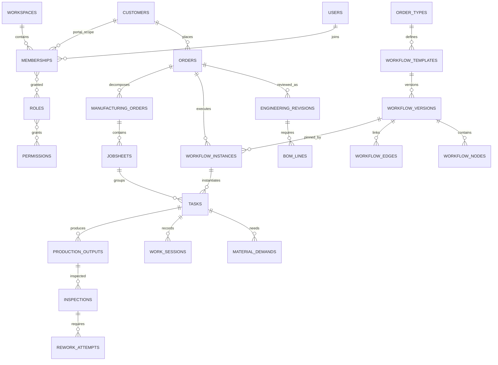
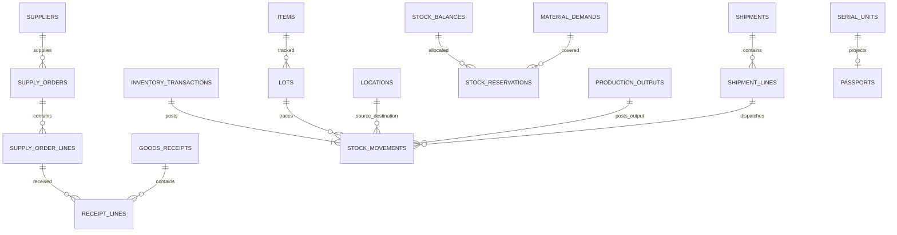

# Database design — SQLite operational model

Status: proposed physical/logical model for R0+R1; not an applied migration.
Architecture and scope: [design.md](design.md). Tables are introduced by milestone, not created speculatively in a single initial migration. Prisma models map to the table names below with explicit mappings; the generated auth-provider schema is reconciled at M0.

## 1. Storage conventions

| Concern | Decision |
| --- | --- |
| IDs | Server-generated UUID text; public human numbers use a separate workspace sequence, never `count + 1` |
| Ownership | Every business table has `workspace_id NOT NULL`; parent relations use composite workspace + ID foreign keys |
| Common mutable columns | `id`, `workspace_id`, `created_at`, `updated_at`, `version`; masters also have `archived_at`; actor fields where a person makes a decision |
| Common immutable event columns | `id`, `workspace_id`, `occurred_at`, `actor_user_id`, `command_id`; append-only events/postings cannot be silently updated/deleted |
| Time | UTC timestamps; business dates `YYYY-MM-DD`; workspace timezone/calendar determines work dates; inject a clock for scenarios |
| Quantity | SQLite INTEGER / Prisma BigInt atoms, 1 base unit = 1,000,000 atoms. Input/output quantities are decimal strings; no JSON BigInt or floating-point stock arithmetic |
| UOM precision | Each base UOM has allowed precision 0–6. Pieces require a multiple of 1,000,000 atoms; fractional kg can use their configured precision. Reject excess precision rather than silently round |
| UOM conversion | Item-scoped positive numerator/denominator, into base UOM; exact conversion and configured precision required. No uncontrolled cross-dimension sums |
| Duration | Planned/actual minutes as integers; timing events keep timestamps; do not store hours as an inventory quantity |
| Money | Integer minor units plus ISO currency and currency precision; rate snapshots retain unit/basis/effective date. First release uses one workspace currency; no implicit FX |
| Configuration | Versioned validated JSON for permitted forms/guard parameters/AI evidence; business identities, stock and relationships remain relational |
| Deletes | Restrict referenced masters; archive them. Draft child removal is permitted only before release and under a command. Evidence/postings are reversed/superseded, not erased |
| Checks | Foreign keys on each connection; SQL checks for positive quantities and legal states; service guards for cross-row conservation and authorization |
| Mutations | Short transaction: idempotency receipt + aggregate/version check + domain writes + audit + workspace revision. Replays never post again |

Prisma migration SQL adds CHECK constraints, partial unique indexes and event/posting immutability triggers where the schema DSL cannot express the invariant. Migration checks introspect them; ORM types alone are not DB guarantees.

## 2. Relationship overview

Diagrams omit some join/event tables for readability. The dictionary below is the model inventory.

## 3. Identity and ownership — M0

| Table | Principal fields / relationships | Important uniqueness or rule |
| --- | --- | --- |
| `users` | Auth-provider user ID, name, normalized email, verified flag, image, active/disabled metadata | Unique normalized email; provider-supported ban/disable schema; profile is not a persona constant |
| `sessions` | Provider session ID/token, user FK, expiry, created/updated metadata | Library-managed tokens/cookies; revoke on logout/disable; never expose token through app read models |
| `accounts` | Provider/account ID, user FK, credential hash/provider fields | Auth-library-managed credential data; do not store plaintext passwords |
| `verifications` | Provider challenge identifier/value/expiry | Generated from pinned library; only implemented account/recovery flows use it |
| `workspaces` | code, name, timezone, currency, revision, demo flag | Unique code; normal business revision advances on committed domain changes |
| `memberships` | user, workspace, status, optional customer FK, optional technician link | Unique user/workspace; customer membership scope is explicit and cannot be changed by browser persona |
| `permissions` | code, description, resource/action | Global unique code; shipped policy catalog rather than arbitrary strings created by users |
| `roles` | workspace, code, name, system/custom flag, active status | Unique workspace/code; no implicit business permission from auth-provider admin role |
| `role_permissions` | workspace, role, permission code | Unique role/permission; permission grant/revoke audited |
| `membership_roles` | workspace, membership, role, granted_by | Unique membership/role; prevent removing the final access administrator without replacement |
| `number_sequences` | workspace, kind, year, next_value | Unique workspace/kind/year; allocate in the same transaction as the numbered record |
| `command_receipts` | workspace, principal, key, request_hash, command_type, resource ID, result JSON, committed_at | Unique workspace/principal/key; same key/different hash returns conflict; rollback must not leave a successful receipt |
| `audit_events` | actor, command, aggregate_type/id, action, before/after revision, detail JSON, timestamp | Append-only; workspace/resource/time indexes; customer projections redact internal facts |

`memberships.customer_id` references a customer master introduced in M1. Stage the FK/link migration when that table exists; bootstrap administrators have no customer scope. Do not invent a circular customer-owned authentication model.

## 4. Organization, commercial and production masters — M1

| Table | Principal fields / relationships | Important uniqueness or rule |
| --- | --- | --- |
| `departments` | code, name, active | Workspace/code unique |
| `work_calendars` | code, name, timezone, weekly shift definitions JSON | Valid non-overlapping working intervals; stable calendar revision |
| `calendar_exceptions` | calendar, date, working intervals/reason | Workspace/calendar/date unique; holidays and exceptional shifts override weekly pattern |
| `customers` | code, legal/display name, address/contact summary, active | Workspace/code unique; archive preserves orders and portal links |
| `customer_contacts` | customer, name, email, phone, role | Same-workspace FK; contacts are not automatically authenticated users |
| `suppliers` | code, name, contact/address, lead-time default, active | Workspace/code unique; bank/AP details outside scope |
| `uoms` | code, name, dimension, precision | Workspace/code unique; precision 0–6; used precision changes cannot reinterpret posted values |
| `items` | code, name/spec, RAW/COMPONENT/WIP/FINISHED, base UOM, NONE/LOT/SERIAL tracking, active | Workspace/code unique; base UOM/tracking policy immutable after first posting except a separately designed migration |
| `item_uom_conversions` | item, input UOM, positive ratio numerator/denominator | Unique workspace/item/input UOM; revision snapshots retained on released BOM/supply lines |
| `locations` | code, name, warehouse group, RAW/WIP/QUARANTINE/FG/EXTERNAL/CONSUMED/SCRAP/CUSTOMER kind, active | Workspace/code unique; virtual boundary locations excluded from physical stock and nonnegative source checks |
| `machine_classes` | code, name, capabilities | Workspace/code unique |
| `machines` | code, name, class, department, calendar, status | Same-workspace references; maintenance/unavailability blocks new bookings |
| `technicians` | membership, name/display code, department, calendar, max weekly minutes, active | Workspace/membership unique; authenticated operator identity resolves through membership |
| `skills` | code, name, scale maximum | Workspace/code unique |
| `technician_skills` | technician, skill, level, assessed_at/by | Unique technician/skill; level in catalog range |
| `certifications` | code, name, issuer label, active | Workspace/code unique |
| `technician_certifications` | technician, certification, issued/valid-until dates, evidence document | No use after expiry; same-workspace evidence linkage |
| `order_types` | code, name, description, default template, active | Workspace/code unique; default must resolve to a published version at order selection/release |

Supplier/customer names are retained as historical label snapshots where needed, alongside real FKs. Item, machine, calendar and role codes are not arbitrary user input inside released process definitions.

## 5. Engineering, orders and workflows — M2

| Table | Principal fields / relationships | Important uniqueness or rule |
| --- | --- | --- |
| `orders` | number, customer, order type, finished item, ordered atoms, requested/promised date, engineering revision, version, lifecycle | Unique workspace/number; positive ordered quantity; controlled DRAFT/REVIEW/READY/RELEASED/IN_PRODUCTION/PARTIALLY_DELIVERED/DELIVERED/CANCELLED transitions |
| `rfq_drafts` | order/draft owner, raw text, extraction source/run, reviewed fields JSON | AI is draft evidence; confirmation creates/updates a real order via command |
| `customer_questions` | order, question, answer, OPEN/ANSWERED/WAIVED, resolved_by/at | Binding release blockers explicitly resolved/waived by authorized engineer; retain history |
| `engineering_revisions` | order, revision number, status, specs JSON, output quantity basis, approver/at | Unique order/revision; approved revision immutable; changes after release require a new reviewed revision |
| `bom_lines` | engineering revision, operation node key, item, input UOM, base requirement atoms, output basis atoms, allowance policy | Positive quantities; snapshot conversion; material consumption derives from reviewed quantities, not AI text |
| `qc_checklists` | code, revision, name, published status | Referenced revisions immutable |
| `qc_checklist_checks` | checklist, code, method, unit, limits/acceptance rule, required flag | Unique checklist/check code; bounded result types and numeric limits |
| `workflow_templates` | order type, code, name, archived status | Workspace/code unique; container for versions |
| `workflow_versions` | template, version number, DRAFT/REVIEW/PUBLISHED/RETIRED, schema version, published_by/at, definition hash | Unique template/version; published contents immutable; order pins version ID |
| `workflow_nodes` | workflow version, key, type OPERATION/INSPECTION/APPROVAL, name, department, permission, planned minutes, resource/skill/cert requirements, form/guard JSON | Unique version/key; bounded registry types; minimum completion/quality requirements explicit |
| `workflow_edges` | version, from/to node, join policy/condition code and validated params | Both endpoints reference nodes in same workspace/version; no scheduling cycles; AND joins initially; arbitrary free text is never executed |
| `workflow_instances` | order, pinned version, engineering revision, status, revision, started/completed_at | One active initial instance per order; explicit attempts/revisions for change, no silent rebind |
| `manufacturing_orders` | order, number, output/department group, lifecycle | Workspace/number unique; target quantities linked to order version |
| `jobsheets` | manufacturing order, order, name, department, instruction revision | Same order/workspace; preserve approved instruction snapshot |
| `tasks` | instance, node, jobsheet, attempt number, status, planned/actual minutes, target item/atoms, assigned technician/machine, version | Unique instance/node/attempt; controlled server transitions; no hero ID assumptions |
| `task_dependencies` | instance, predecessor task, successor task, policy | Both tasks belong to same instance; explicit additional rework dependencies; no bare IDs from another order |
| `material_demands` | task/order, BOM line, item, required atoms, need-by date, status | Requirement is independent of hard reservation and expected supply; remaining need derived from committed issue/consume/return events |
| `workflow_events` | instance/task, from/to status, action, actor, command, attempt, evidence IDs | Append-only; generic runtime emits event only with successful business writes |

Workflow release transaction: recheck approved engineering + published process + master validity; allocate order/work numbers; create pinned instance/MO/jobsheets/tasks/dependencies/demand; add audit; increment revisions; commit. Repeating confirmation returns the same created resource.

## 6. Purchasing and inventory — M3

| Table | Principal fields / relationships | Important uniqueness or rule |
| --- | --- | --- |
| `supply_orders` | supplier, number, status, expected date, approver, currency | DRAFT/APPROVED/PARTIALLY_RECEIVED/CLOSED/CANCELLED; approval creates expected supply only |
| `supply_order_lines` | supply order, item, ordered base atoms, input qty/UOM/conversion snapshot, unit price snapshot, expected date | Same-workspace item; received/open derived from net receipt lines; no invented stock |
| `goods_receipts` | number, supplier/supply order, received_at/by, source reference, status | Posted receipt immutable; corrections use linked reversal |
| `receipt_lines` | receipt, source line, item, lot, actual atoms, destination location, incoming disposition | Must match item/UOM/source and remaining receivable quantity; posted only once |
| `lots` | item, lot code, origin kind, supplier/receipt or production output reference, manufacturing/expiry dates | Unique workspace/item/lot code; origin links populated as the corresponding records post |
| `serial_units` | item, lot, serial, produced/received reference, current disposition | Workspace/serial unique; tracked movement represents exactly one base piece; no duplicate QC acceptance |
| `inventory_transactions` | number, kind, command, posting time/actor, source document reference, reversal_of, reason | Append-only; exactly one transaction per posting command; explicit reason for adjustment/reversal |
| `stock_movements` | transaction, item, lot/serial, positive atoms, source/destination location and disposition, order/task/receipt/output/shipment references | Source and destination cannot be identical in both location and disposition; recorded conversion/unit; immutable lines |
| `stock_balances` | item, lot/serial scope, location, disposition, on-hand atoms, reserved atoms, version | Unique stock bucket; on-hand/reserved nonnegative; reserved <= eligible on-hand. Projection reconciles to movements |
| `stock_reservations` | demand, balance bucket, original/remaining atoms, ACTIVE/ISSUED/RELEASED, command and actor | Same item/workspace; cannot reserve quarantine/WIP; conditional balance update prevents oversubscription |
| `inventory_counts` | location, count date, reason, DRAFT/SUBMITTED/APPROVED/POSTED, approver | Book snapshot is versioned; stale count needs reconciliation before posting |
| `inventory_count_lines` | count, item/lot/bucket, book atoms, counted atoms | Count delta posts one authorized adjustment; no direct quantity overwrite |

**Movement semantics:** external supplier → raw/quarantine is receipt; raw → WIP is issue/transfer; WIP → consumed is actual consumption; WIP → raw is unused return; production boundary → FG quarantine is output; quarantine → released is QC reclassification; FG → customer boundary is shipment; physical → scrap boundary is disposal. Virtual boundaries are not available stock.

Physical stock is a projection of posted movements; `stock_balances` is a transactionally maintained query/locking aid, not a separate editable source. Since nullable lot/serial keys can weaken SQLite uniqueness, normalize the bucket key (explicit sentinel key or a generated normalized key with a unique index) and test the no-lot case. Do not rely on `UNIQUE(item_id, lot_id, location_id)` with nullable lot IDs alone.

Reservations only allocate eligible physical stock; future shortages remain demand or expected supply. Issuing releases/decrements the relevant hard reservation in the same transaction. Receipt, issue and consumption must not double-debit the same warehouse stock.

## 7. Planning, execution, quality and delivery — M4

| Table | Principal fields / relationships | Important uniqueness or rule |
| --- | --- | --- |
| `resource_bookings` | task, machine or technician, start/end, reserved minutes, status, version | Exactly one resource target per row; active overlapping bookings/capacity totals checked within the command transaction |
| `work_sessions` | task/attempt, technician, start/pause/end, effective minutes | At most one active session per operator and task as policy; partial unique index; timer is derived from timestamps, not browser tick state |
| `production_outputs` | task/attempt, item, lot/serial, produced atoms, engineering/version references, command | Unique posting command; intermediate outputs do not increment final ordered-unit output; approved final-node policy determines order totals |
| `inspections` | incoming receipt or production output, checklist revision, inspected atoms, pass/rework/scrap atoms, inspector, status | Exactly one source; outcomes reconcile to inspected population; reinspection links the same held units and attempt |
| `inspection_results` | inspection, check, measured value/result, defect/evidence | Typed check validation, required results before finalize |
| `rework_attempts` | failed inspection/units, parent task/instance, attempt number, instruction, status, approving actor | Explicit scope of held units; schedules new attempt without unconditional CPM cycle; no new physical units on reinspection |
| `shipments` | number, customer/order, planned/dispatch/delivery dates, status, carrier/reference | DRAFT/ALLOCATED/DISPATCHED/DELIVERED/CANCELLED; destination and order customer scope fixed |
| `shipment_lines` | shipment, order, item/lot/serial, allocated/dispatched atoms | Accepted FG only; shipment allocation reserves stock; dispatch consumes the reservation once; cumulative shipped <= fulfillable accepted output |
| `promise_acknowledgments` | customer membership, order, promise revision, accepted_at/comment | Unique customer/order/promise revision; acknowledgment never grants internal data access |
| `passports` | serial unit, order, published view revision, release status | Unique workspace/serial unit; derives actual process/QC/shipment evidence, no sample hash or certification claims |
| `documents` | opaque storage key, original name, media type, size, checksum, uploader, status | Private storage; allowlisted type/size; checksum is file integrity, not a certification/ledger claim |
| `document_links` | document, exactly one typed order/task/inspection/passport parent, revision, customer_visible | Composite ownership FKs; download also authorizes parent and visibility. No arbitrary caller-supplied disk path |

Order counters are derived from attributed final output, accepted distinct unit/lot quantities and shipments. If cached on orders, update them only inside posting transactions and reconcile. Keep `0 <= qcAccepted <= completed` and configured overproduction policy; reject overproduction in the initial release. Shipped quantity is separate and does not reduce cumulative historical QC acceptance.

## 8. Intelligence and recoveries — M5

| Table | Principal fields / relationships | Important uniqueness or rule |
| --- | --- | --- |
| `disruptions` | type MATERIAL_DELAY/MACHINE_DOWN/TASK_OVERRUN, scoped target, effective period, parameter delta, status | Valid target type and approved input; simulation versus applied event explicitly separated |
| `schedule_runs` | workspace/aggregate revision, clock/calendar/input hash, status, computed at, result summary | Immutable computed snapshot; never silently display old run against newer inputs |
| `schedule_task_results` | run, task, ES/EF/LS/LF, slack, critical path, feasibility/reasons | Unique run/task; units/minutes explicit |
| `recovery_plans` | affected order/disruption, base revision, status, selected option, approver/at | Cannot approve stale/already applied proposal; no choice bypasses workflow/inventory checks |
| `recovery_options` | plan, type, typed proposed commands, simulation result, feasibility/reasons, rate/input evidence | Validated bounded commands only; actual input-based cost/time or explicitly unavailable, not fixed percentages |
| `planning_policies` | scope/family/operation, version, padding/buffer rule, evidence requirement, approved actor | Policy distinct from measured mean/variance; no evidence implies insufficient history |
| `ai_runs` | function, actor/scope, snapshot revision/hash, provider/model/prompt/schema version, status, source, response/ref JSON, duration | AI/COMPUTED/UNAVAILABLE/MOCK distinct; no raw secrets; no cross-scope stale-cache reuse |

Factory Memory queries completed execution/QC/rework records by family/operation/material/machine class and version. Seeded historical runs, if used, are imported into those evidence models with `source=DEMO_BASELINE`; they are not invented in UI. Append-only real events feed later estimates. Add material/labor/rate snapshots to transaction evidence when known; full P2 cost/profit ledgers are not introduced in R0/R1.

## 9. Lifecycle and invariant ownership

| Aggregate | Allowed lifecycle | Command boundary |
| --- | --- | --- |
| Workflow version | DRAFT → REVIEW → PUBLISHED → RETIRED | Author/review/publish grants; immutable after publish |
| Engineering revision | DRAFT → REVIEW → APPROVED → SUPERSEDED | Engineering author/reviewer; cannot mutate the revision pinned by running work |
| Order | DRAFT → REVIEW → READY → RELEASED → IN_PRODUCTION → PARTIALLY_DELIVERED → DELIVERED | Release requires valid masters/approved spec/published process; stock reservation may remain a shortage gate for task start rather than blocking order visibility |
| Task | PENDING/READY → ASSIGNED → RUNNING ↔ PAUSED → WAITING_QC/COMPLETED, or BLOCKED/CANCELLED by authorized guards | Preconditions, quantity gates and attempts determine transitions; a button cannot set arbitrary status |
| Supply order | DRAFT → APPROVED → PARTIALLY_RECEIVED → CLOSED | Received quantity comes from actual receipts; explicit cancellation/return policy preserves custody |
| Inspection | DRAFT → FINALIZED, then reinspection through a new linked record | Required check results, inspector grant, disposition posting |
| Shipment | DRAFT → ALLOCATED → DISPATCHED → DELIVERED | QC-released units and reservations checked at allocation and dispatch |
| Recovery | PROPOSED → APPROVED/APPLIED or REJECTED/STALE | Simulation revision checked, actual business commands and audit atomic |

Each status enum in the final migration/contracts is checked against this table. No hidden alternative string such as `PLANNED` is accepted without mapping the existing demo types explicitly during migration.

## 10. Indexes, concurrency and migrations

- Composite FKs require `UNIQUE(workspace_id, id)` on referenced business parents. Index child relation columns, operational list filters `(workspace_id,status,updated_at,id)`, and stock buckets.
- Use optimistic aggregate versions for edit/approval and conditional stock-bucket updates for reservations. A process-local mutex alone is not a cross-process integrity guarantee.
- A transaction retries a bounded SQLite-busy conflict with the same command identity; after its limit return a retryable error. No HTTP success before commit.
- Append-only triggers protect movements/events from accidental UPDATE/DELETE; corrections use new linked entries. The migration owner can explicitly migrate schemas; ordinary application APIs have no raw SQL escape hatch.
- Migrations in order: M0 access/shared infrastructure; M1 masters; M2 engineering/workflows/orders; M3 supply/stock; M4 execution/QC/delivery/files; M5 intelligence. Include migration-from-previous milestone checks.
- Seed empty DB once. The legacy hero fixture is a sandbox import: 120 ordered, 82 completed, 78 accepted; create reconcilable opening/evidence records and distinguish outstanding demand from hard reservations. Do not copy `reserved=42` at stock 0 as a valid hard reservation.
- Normal startup never resets data. A destructive demo reset is restricted to an isolated demo workspace and requires explicit confirmation; no global truncate on a running workspace.
- Backup through SQLite's consistent backup facility; include private files and a manifest. Restore to a separate path and run FK/integrity/reconciliation checks before switching an application to it.

Implementation verification uses `PRAGMA foreign_key_check`, integrity checks, balance-vs-ledger queries, active-reservation reconciliation, unique command replay, wrong-workspace FKs, over-shipment and two concurrent reservation attempts. A migration that merely creates table names is not accepted as completion.
