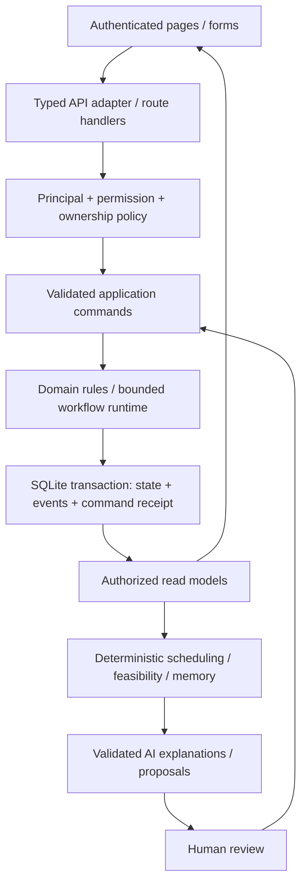

# ManuOS functional prototype — design brief

Date: 2026-10-15. Status: implementation proposal prepared for review; not shipped functionality.

## Confirmed direction

- User selected operational functionality **and all six intelligence capabilities**, delivered in stages, with **SQLite**.
- Preserve Next.js/React/TypeScript, English product copy, self-hosted Plus Jakarta Sans, light blue/neutral design and balanced density.
- Build a usable manufacturing prototype: records, authorized commands, real stock/work/quality/delivery changes, and evidence-backed intelligence. Seeded outcomes alone are insufficient.
- This request authorizes planning. Application implementation, deployment, publishing, commits and pushes are separate actions.
- Reference audits: `docs/product-foundation-gap-audit.md`, particularly sections 9–14. These design files supersede the narrower initial SQLite proposal.

## Deliverables and reading order

1. This brief: boundaries, architecture and milestone outcomes.
2. `database.md`: data dictionary, relationships, versioning, quantities and SQLite strategy.
3. `ui-pages.md`: navigation, route catalog, page anatomy, responsive interactions and UI delivery order.
4. `api-rbac.md`: permission matrix, endpoint/command contracts, errors and concurrency.
5. `acceptance.md`: deterministic fixtures and proof required for completion.
6. `../../plans/2026-10-15-manuos-functional-prototype.md`: ordered work packages, exact source boundaries, checks and rollout.

Visual review artifact: [representative wireframes](ui-wireframes.html), five switchable page layouts with illustrative records. It contains no application API/DB calls; business buttons are disabled and source labels are explicit. Open locally to inspect desktop/mobile composition; no browser render is claimed in this planning pass.

All file paths proposed for application changes are future work unless explicitly described as existing. No design artifact is evidence of an implemented API, database or UI.

## Milestones and roadmap

Roadmap P0/P1/P2 denotes product priority. **M0–M6 below denote implementation milestones**, to avoid confusing those labels.

| Milestone | Deliverable | Exit outcome |
| --- | --- | --- |
| M0 | Contracts, DB/bootstrap, authentication and authorization | A real user can log in; unauthorized operations fail; a durable empty workspace works |
| M1 | Manageable masters and shared UI | Create customer/supplier/item/location/resources/order type without editing code |
| M2 | Engineering and bounded workflow engine | Publish a versioned process; release a reviewed order into actual production work |
| M3 | Material Readiness/inventory/basic supply | Receive/reserve/issue/consume/return stock with a reconcilable ledger |
| M4 | Planning, execution, QC/rework, delivery and portal | Complete a new order; stock, evidence, shipments and customer visibility reconcile after restart |
| M5 | Six intelligence capabilities plus Command Center | Explain/compute/recommend against actual authorized records; validated human decisions change real plans |
| M6 | Operational hardening and reproducible demo | Second order type/customer, failure cases, backup/restore, responsive browser flow and live AI evidence pass |

**R0 = M0–M4** is a usable operational milestone. **R1 = M5–M6** is the selected proper-prototype target, including all six intelligence features. R0 alone is not presented as completion of this plan. Cost Intelligence P2 is excluded from implementation acceptance, but source measurements/rates retain provenance for it.

### In scope

- One initially configured manufacturing workspace on one SQLite-backed server. Workspace IDs and membership checks remain explicit; support a second test workspace for isolation checks.
- Internal users and customer accounts, email/password auth, persisted sessions/revocation, user provisioning and role/permission grants.
- Masters: customer/contact, supplier, item/material/product/UOM, locations, departments, calendars, machines/classes, technician skills/certifications, order types.
- RFQ/manual order entry, actual reviewed engineering revisions/BOM/QC requirements, order detail/lifecycle and real document attachments.
- Versioned workflow definitions and a bounded server-side runtime with operation, inspection and approval actions; parallel AND joins and explicit rework attempts.
- Opening balances, basic supply orders and partial receipt, quality disposition, reservations, stock movement/consumption, output, counts/corrections and shipments.
- Actual assignment/time/output/QC/rework, factual passports and customer-owned order views/acknowledgments.
- Production Brain, Promise Engine, Dependency Intelligence, Self-Healing Production, Engineering Copilot, Factory Memory. See exact acceptance per feature in `acceptance.md`.

### Deferred depth

- Full accounting/AP/AR/invoice/tax/payroll, financial inventory valuation and Profit/Cost Intelligence UI.
- Enterprise SSO, public self-service tenant signup, distributed workflow platform, arbitrary executable workflow scripts/BPMN, IoT and camera-based Visual QC.
- Full marketplace/bilateral cross-company Factory Network, distributed capacity trading and automated supplier integrations. Basic purchasing and supplier receipt are in scope; subcontract recovery is unavailable unless its actual partner/capacity/receipt path is implemented.
- Broad CRM, complex quote-pricing, advanced WMS/bin optimization and comprehensive RMA/credit-note processes.

Existing Factory Network demo surfaces may remain clearly isolated/labeled as previews during transition; they cannot post into the new ledger via legacy store mutations. This is a proposed release boundary based on the supplied roadmap, not a claim that the old competition scope never included network features.

## Architecture decision

Use a **modular monolith**: Next.js route handlers → authenticated application services → pure domain engines/repositories → SQLite through Prisma. Keep the current app framework and visual identity; avoid introducing a second backend or a generic business scripting framework.



- **Prisma + SQLite** is the proposed data-access stack, using the supported SQLite adapter for the version selected at M0. Check package/runtime/container compatibility together; never blindly pin the latest major into the current Node 20 container.
- **Better Auth with its Prisma adapter** is the proposed auth provider. Generate its supported auth schema at the pinned version; use library-managed credentials/session handling. Application permissions/ownership are enforced separately from provider administration roles.
- Public signup is disabled. Bootstrap the first administrator through a server-only CLI; subsequent account provisioning is a protected action using supported auth-provider APIs. Do not commit demo passwords or silently claim email verification/delivery.
- Server read models are the operational source. Adopt TanStack Query for fetched projections/mutation invalidation; keep Zustand for UI selections/dialogs and temporary drafts only. Remove all client-authoritative operational mutations as their modules migrate.
- Zod defines application input/output contracts. Routes contain transport code; services enforce domain authorization and rules. Do not accept a browser-supplied complete graph as a write.
- No provider call, file upload stream or long computation inside an open SQLite write transaction. Capture a revision, compute outside, then revalidate/apply in a short transaction.
- Auth cookies, mutation-origin checks and authorization apply to AI endpoints and document downloads as well as operational commands.

## Folder and module boundaries

```text
prisma/schema.prisma, prisma/migrations/, prisma/seed.ts
src/server/db/{client,transaction}.ts
src/server/auth/{auth,principal,policy,permissions,provisioning}.ts
src/server/http/{errors,route-handler}.ts
src/server/modules/{masters,orders,engineering,workflow,inventory,supply,
                   planning,execution,quality,delivery,portal,intelligence}/
  contracts.ts       Zod inputs/read models and shared type exports
  repository.ts      Scoped database queries only
  service.ts         Authorized commands and transaction orchestration
src/server/ai/{gemini-client,context,validation,cache,provenance}.ts
src/domain/{quantity,transitions,commands,errors}.ts
src/engines/         Pure deterministic computation, dependency-injected time/policies
src/lib/api/{client,query-keys}.ts
src/features/<module>/{api,hooks,components}/
src/app/(auth)/, src/app/(workspace)/, src/app/(customer)/
tests/integration/, tests/e2e/, tests/fixtures/
scripts/{bootstrap-admin,backup-db,restore-db,verify-reconciliation}.ts
```

Do not create every proposed file on day one. Introduce a module only with its first working slice. A service growing into several unrelated commands should split into named command files within that module, without centralizing every business action in another `graph-store.ts`.

## Non-negotiable domain behavior

- Names are labels, not foreign keys. Orders pin customer ID, type, published workflow and reviewed engineering revision.
- Published/released versions are immutable; a new version never silently rewrites running work.
- Stock movements are posted records, not arbitrary counter edits. Demand, expected supply, physical stock, hard reservation and usable availability are distinct.
- Physical output, accepted output, shipment allocation and shipped quantity are distinct. Reinspection, approval and receipt retries cannot manufacture quantity.
- Scheduling dependencies remain acyclic. Rework creates an explicit attempt/transition and evidence rather than an unconditional CPM cycle.
- Action authority comes from a live server session/membership and object ownership, never from client persona/actor strings.
- Ordinary operations use actual workspace time/calendar. The 2026-11-24 hero clock belongs only to an explicitly labeled sandbox fixture.
- Core operations work without Gemini. Unavailable AI, missing history and uncertain feasibility are explicit states; fixed examples never masquerade as computed/live evidence.

## Existing-code disposition

| Existing area | Planned treatment |
| --- | --- |
| `components/app-shell.tsx`, sidebar/topbar/dialog/primitives | Preserve visual vocabulary; add query/auth providers, route-aware navigation, permission projection and responsive shared states |
| `store/graph-store.ts` | Keep isolated demo mode temporarily; replace business arrays/actions module-by-module with server read/command adapters; final normal app cannot import operational seed arrays |
| `domain/types.ts`, schemas | Split/extend into contracts and domain types after DB ownership/version/quantity conventions; preserve required historic seed meanings |
| CPM/ripple/capacity/recovery/dispatch/similarity engines | Reuse tested algorithm ideas; remove hero IDs/dates/fake defaults and connect real callers; input-sensitivity tests before trusting outputs |
| AI routes/helper | Preserve server-only provider boundary; replace browser snapshots/canned `aiResult` outputs with authorized contexts, validation, provenance and bounded requests |
| Intake drawer and `/orders/new` | One shared order/engineering flow; no duplicate independent confirmation logic |
| Passport route and customer views | Lookup actual scoped evidence; unknown/unauthorized serials return not found |
| Existing docs/fixture | Keep provenance/history; replace completion claims only with fresh per-feature evidence |

## Hosting and operations

Default: local development and one application server with a durable local disk/volume for SQLite and private files. Back up using a consistent SQLite backup method and file manifest; verify restore into a separate directory. SQLite WAL depends on same-host readers/writers; do not mount one WAL database across multiple app hosts or assume the existing Cloud Run container provides durable storage.

Use one migration runner and short transactions; read back foreign-key enforcement and reconciliation. `DATABASE_URL`, auth URL/secret, upload root and provider configuration are server-only. No production secrets or DB files enter Git. Cloud Run or multi-instance rollout is a separate storage/deployment decision.

## Completion and review

Every task has UI/API/rule/DB readback proof and meaningful failure coverage. M6 completes only after R0+R1 acceptance, fresh-browser and restart continuity, mobile/tablet/desktop paths, backup/restore, and one real provider success for each AI-assisted path claimed live. Tests/mocks and live evidence are reported separately.

Review the package for scope, entities, permissions and user flows before application execution. Any revised library version or public provider behavior must be checked against primary documentation at implementation time.

References checked for this design: [Prisma SQLite](https://docs.prisma.io/docs/prisma-orm/quickstart/sqlite), [Better Auth Prisma adapter](https://better-auth.com/docs/adapters/prisma), [Better Auth options](https://better-auth.com/docs/reference/options), [SQLite foreign keys](https://www.sqlite.org/foreignkeys.html), [SQLite WAL](https://www.sqlite.org/wal.html).
